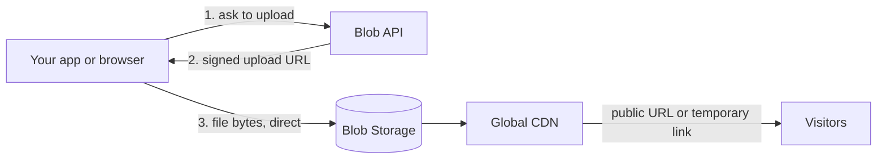

Blob Storage is Vertra Cloud's object storage for files your application handles but does not build: user uploads, images, videos, exports and backups. Files are stored once, served from a global CDN, and managed through the [API](/api-reference/endpoint/blob/objects/list), the [SDKs](/blob/sdk-javascript), the dashboard or any S3-compatible tool.

It is separate from your application's own disk. Anything you store here survives redeploys and is not counted against the application's storage.

## How it works

1. Your code calls the API with an [API key](/blob/authentication) (or a browser uses a short-lived upload token).
2. Files up to 100 MB can go in a single request. Larger files, up to 10 GB, are sent straight to storage with a signed URL, so the bytes never pass through the API. See [Uploads](/blob/uploads).
3. The file is served from the global CDN through a stable public URL, or through a [temporary link](/blob/links-and-visibility) when it is private.

## Public and private files

Every file is either **public** or **private**, and new files are **private** unless you say otherwise.

| | Public | Private |
|---|---|---|
| Address | Permanent URL on `blob.vertracloud.dev` | None; you create a temporary link or a share |
| Who can read | Anyone with the URL | Only your credentials, or a link you issued |
| Cached by the CDN | Yes | No |
| Typical use | Avatars, site images, downloads | Invoices, backups, user documents |

You can switch a file between the two at any time without changing its `id`. Details in [Links and visibility](/blob/links-and-visibility).

## Safe by default

- **Blocked file types.** Executables and installers are refused: `exe`, `msi`, `dll`, `bat`, `cmd`, `com`, `scr`, `ps1`, `apk`, `dmg`, `pkg`, `deb`, `rpm`, `appimage` and a few others. Files that are really executables are rejected even when renamed.
- **HTML, SVG and XML are always downloads.** Files ending in `.html`, `.htm`, `.svg`, `.xml` or `.xhtml` are always served as a download, never rendered in the browser, so a user upload cannot run as a web page on your files' address.
- **Content type from the extension.** The platform sets the content type itself, so it cannot be spoofed at upload time.
- **Other accounts' files never leak.** Asking for a file id that is not yours answers "not found".

## Cache

Public files are cached by the CDN. Set `cache_control` per file or per folder to `immutable` or `max-age=N`. The `no-cache` mode is available on the highest Enterprise tiers; see [Limits and quotas](/blob/limits-and-quotas). Overwriting or deleting a public file clears its cached copy.

## What is included

<CardGroup cols={2}>
  <Card title="Uploads" icon="upload" href="/blob/uploads">Simple, direct and resumable multipart uploads.</Card>
  <Card title="Sharing" icon="share-nodes" href="/blob/sharing">Share pages with expiry, download limits and a password.</Card>
  <Card title="Folder rules" icon="folder-tree" href="/blob/folder-rules">Defaults and limits per folder.</Card>
  <Card title="Image transformations" icon="image" href="/blob/image-transformations">Resize and convert through the URL.</Card>
  <Card title="S3 compatibility" icon="plug" href="/blob/s3-compatibility">Use aws-cli, rclone or boto3.</Card>
  <Card title="Custom domains" icon="globe" href="/blob/custom-domains">Serve files from your own subdomain.</Card>
</CardGroup>

## FAQ

<AccordionGroup>
  <Accordion title="Which plans include Blob Storage?">
    Every plan has a storage quota, starting at 1 GB on Economy. The full table is in [Limits and quotas](/blob/limits-and-quotas).
  </Accordion>
  <Accordion title="What is the largest file I can store?">
    10 GB per file. Files above 100 MB use the direct upload flow.
  </Accordion>
  <Accordion title="Can I change a file's URL?">
    The public URL is built from the file's path. Moving a file changes its path (and URL) but keeps its `id`, so store the `id` if you need a stable reference.
  </Accordion>
  <Accordion title="What happens to my files if my plan expires?">
    They stay for 72 hours in a grace period and are then permanently deleted, without a backup. See [Limits and quotas](/blob/limits-and-quotas#expiration-and-deletion).
  </Accordion>
</AccordionGroup>

Next: the [Quickstart](/blob/quickstart).
