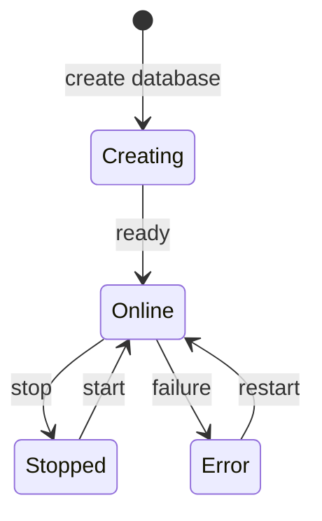

## What is a managed database on Vertra Cloud?

A managed database on Vertra Cloud is a PostgreSQL, MongoDB, Redis or MySQL instance that the
platform provisions, secures and monitors for you: TLS is mandatory, the CA, server and client
certificates are generated automatically, and each database runs in its own container with
dedicated memory and storage.

## Which database engines are available?

Four: PostgreSQL (18 or 17), MongoDB (8.0 or 9.0), Redis (8.2 or 7.2) and MySQL (9.7 or 8.4). You pick the version when you create the database and the recommended one is the default. Every engine requires TLS **and a client
certificate** — a password alone never connects.

<CardGroup cols={2}>
  <Card title="PostgreSQL 18 / 17" icon="elephant">
    Relational database with full SQL, JSONB and extensions support.

    **User**: `vertracloud` &nbsp;|&nbsp; **Database**: `vertracloud` &nbsp;|&nbsp; **Auth**: password + client certificate
  </Card>
  <Card title="MongoDB 8.0 / 9.0" icon="leaf">
    NoSQL document-oriented database for flexible data.

    **User**: `vertracloud` &nbsp;|&nbsp; **Database**: `vertracloud` &nbsp;|&nbsp; **Auth database**: `admin` &nbsp;|&nbsp; **Auth**: password + client certificate
  </Card>
  <Card title="Redis 8.2 / 7.2" icon="bolt">
    In-memory storage for high-performance caching, queues and pub/sub.

    **User**: `vertracloud` &nbsp;|&nbsp; **Auth**: user + password + client certificate
  </Card>
  <Card title="MySQL 9.7 / 8.4" icon="database">
    Popular relational database with ACID transactions and large ecosystem.

    **User**: `vertracloud` &nbsp;|&nbsp; **Database**: `vertracloud` &nbsp;|&nbsp; **Auth**: password + X509 client certificate
  </Card>
</CardGroup>

## Which user do I connect with?

Databases created from [v26.4.8](/changelog/v26-4-8) on give you the user `vertracloud` and a default database
named `vertracloud`. It owns your data and, depending on the engine, can create databases and roles (PostgreSQL),
use every database (MongoDB) or run every data command (Redis). As on other managed database services, server-level
administration (server settings, admin users, backups and restores) is handled by the platform.

Databases created before that keep the engine's user: `postgres` (database `postgres`) on PostgreSQL, `default` on
MongoDB and Redis, and `root` (database `default`) on MySQL. The `username` field in
[Get Database](/api-reference/endpoint/databases/get) always tells you which one to use.

## What do I need to connect?

Four things, all on the database page in the dashboard (or through the API):

- **Host** — `<database-id-without-hyphens>.db.usa1.vertraweb.app`, shown on the database page and in
  [Get Database](/api-reference/endpoint/databases/get).
- **Port** — **unique per database**, not the engine's default (5432, 27017, 6379, 3306). Always
  copy it from the database page or the API response.
- **User** — `vertracloud` (or the engine's user on older databases), shown on the database page and as `username` in
  [Get Database](/api-reference/endpoint/databases/get).
- **Password** — shown on the database page; [reset it](/api-reference/endpoint/databases/credentials/resetpassword) if needed.
- **Certificates** — download them in the database's **Certificates** tab or through
  [Get Database Certificate](/api-reference/endpoint/databases/credentials/get):

| File | What it is | Use it as |
|---|---|---|
| `certificate-<id>.ca.pem` | The CA that signs the database's server certificate | CA file (`ca`, `sslrootcert`, `--cacert`, `tlsCAFile`, `--ssl-ca`) |
| `certificate-<id>.crt` | Your client certificate — **not** the CA | client certificate (`cert`, `sslcert`, `--cert`, `--ssl-cert`) |
| `certificate-<id>.key` | Your client private key | client key (`key`, `sslkey`, `--key`, `--ssl-key`) |
| `certificate-<id>.pem` | Bundle: client key + client certificate + the CA, in that order | MongoDB's certificate-key file (`tlsCertificateKeyFile`) |
| `certificate-<id>.p12` | Your client key and certificate as PKCS#12, empty password | drivers that only take a PKCS#12 identity, such as [Prisma 6](#how-do-i-connect-with-prisma-6) |

Most connections need three of them: `.ca.pem`, `.crt` and `.key`. Older databases may not offer the
`.ca.pem`; there, use the `.pem` as the CA file, since the CA is its last part.

The server certificate matches the database host, so full verification (`verify-full`,
`VERIFY_IDENTITY`, `rejectUnauthorized: true`) works. Keep the `.key`, `.pem` and `.p12` files private —
they authenticate as you. [Resetting the certificates](/api-reference/endpoint/databases/credentials/reset)
issues new ones and invalidates the old files.

## How do I connect to each engine?

In the examples, `<host>`, `<port>` and `<password>` come from the database page, the user and database are
`vertracloud` (swap in your database's `username` if it was created before v26.4.8), and
`certificate.ca.pem` / `certificate.crt` / `certificate.key` / `certificate.pem` are the downloaded files.

<Tabs>
  <Tab title="PostgreSQL">
    ```javascript Node.js (pg)
    const { Pool } = require('pg');
    const fs = require('fs');

    const pool = new Pool({
      host: '<host>',
      port: <port>,
      user: 'vertracloud',
      password: '<password>',
      database: 'vertracloud',
      ssl: {
        ca: fs.readFileSync('certificate.ca.pem'),
        cert: fs.readFileSync('certificate.crt'),
        key: fs.readFileSync('certificate.key'),
        rejectUnauthorized: true,
      },
    });
    ```

    ```python Python (psycopg)
    import psycopg

    conn = psycopg.connect(
        host="<host>", port=<port>, user="vertracloud", password="<password>", dbname="vertracloud",
        sslmode="verify-full", sslrootcert="certificate.ca.pem",
        sslcert="certificate.crt", sslkey="certificate.key",
    )
    ```

    ```bash psql
    psql "host=<host> port=<port> dbname=vertracloud user=vertracloud password=<password> sslmode=verify-full sslrootcert=certificate.ca.pem sslcert=certificate.crt sslkey=certificate.key"
    ```
  </Tab>
  <Tab title="MongoDB">
    The user lives in the `admin` database, so the URI always needs `authSource=admin`.

    ```javascript Node.js (mongodb)
    const { MongoClient } = require('mongodb');

    const client = new MongoClient('mongodb://vertracloud:<password>@<host>:<port>/vertracloud?authSource=admin', {
      tls: true,
      tlsCAFile: 'certificate.ca.pem',
      tlsCertificateKeyFile: 'certificate.pem',
    });
    ```

    ```bash mongosh
    mongosh "mongodb://vertracloud:<password>@<host>:<port>/vertracloud?authSource=admin" --tls --tlsCAFile certificate.ca.pem --tlsCertificateKeyFile certificate.pem
    ```
  </Tab>
  <Tab title="Redis">
    ```javascript Node.js (ioredis)
    const Redis = require('ioredis');
    const fs = require('fs');

    const redis = new Redis({
      host: '<host>',
      port: <port>,
      username: 'vertracloud',
      password: '<password>',
      tls: {
        servername: '<host>',
        ca: fs.readFileSync('certificate.ca.pem'),
        cert: fs.readFileSync('certificate.crt'),
        key: fs.readFileSync('certificate.key'),
      },
    });
    ```

    ```bash redis-cli
    redis-cli -h <host> -p <port> --user vertracloud -a <password> --tls --cacert certificate.ca.pem --cert certificate.crt --key certificate.key
    ```
  </Tab>
  <Tab title="MySQL">
    ```javascript Node.js (mysql2)
    const mysql = require('mysql2/promise');
    const fs = require('fs');

    const connection = await mysql.createConnection({
      host: '<host>',
      port: <port>,
      user: 'vertracloud',
      password: '<password>',
      database: 'vertracloud',
      ssl: {
        ca: fs.readFileSync('certificate.ca.pem'),
        cert: fs.readFileSync('certificate.crt'),
        key: fs.readFileSync('certificate.key'),
      },
    });
    ```

    ```bash mysql
    mysql -h <host> -P <port> -u vertracloud -p vertracloud --ssl-mode=VERIFY_IDENTITY --ssl-ca=certificate.ca.pem --ssl-cert=certificate.crt --ssl-key=certificate.key
    ```
  </Tab>
</Tabs>

<Warning>
  A connection with only the password — or with TLS but without the client certificate — is refused
  by every engine. Most "connection refused" or "handshake failed" errors are a missing `.crt`/`.key`
  or the engine's default port used instead of the database's own port.
</Warning>

### Why does my database connection fail?

Almost every failure is one of three things: the wrong port, a certificate file in the wrong place,
or the wrong user. Find the message you got below; the examples come from Node.js (`pg`), and other
drivers word the same cause differently.

| Error message | Cause | Fix |
|---|---|---|
| `ECONNREFUSED` / `ETIMEDOUT` / `Connection refused` | Wrong port (the engine's default instead of the database's own) or the database is not **Online** | Copy the port from the database page and check the status |
| `self-signed certificate in certificate chain` (`SELF_SIGNED_CERT_IN_CHAIN`), `certificate verify failed` | The CA is missing or is the wrong file — usually the `.crt` passed as the CA | Pass the `.ca.pem` as the CA (`ca`, `sslrootcert`, `--cacert`) |
| `key values mismatch` (`ERR_OSSL_X509_KEY_VALUES_MISMATCH`) | The client certificate and the key are not a pair: files swapped (the `.ca.pem` passed as the certificate), from different databases, or from before a certificate reset | Use the `.crt` and the `.key` from the same download |
| `connection requires a valid client certificate` | TLS is on, but the client certificate and key were not sent | Add the `.crt` and the `.key` (`cert`/`key`, `sslcert`/`sslkey`) |
| `pg_hba.conf rejects connection ... no encryption` | TLS is off | Turn TLS on with the three files; a plain connection is always refused |
| `pg_hba.conf rejects connection ... user "postgres"` | Wrong user: databases created from v26.4.8 on use `vertracloud` | Use the user shown on the database page (`username` in the API) |
| `password authentication failed for user` | Wrong password, or it changed after **Reset Password** | Copy the password again and restart the application |
| `Hostname/IP does not match certificate's altnames` | Connected by IP address or by another name | Connect by the host shown on the database page |
| `ENOENT: no such file or directory` | The certificate path does not exist where the process runs | Paths are relative to the working directory; check the files were deployed |
| `Error opening a TLS connection` (Prisma `P1011`) | Same causes as the certificate rows above | See [Prisma 6](#how-do-i-connect-with-prisma-6) |

Situations that cause these errors without an obvious reason:

- **`sslmode` in the URL overrides the `ssl` object (Node.js `pg`, Drizzle).** When you pass both a
  `connectionString` with `?sslmode=require` and an `ssl: { ca, cert, key }` object, the URL wins and
  the files are ignored, so you get `self-signed certificate in certificate chain` even with the right
  files. Use one or the other: the `ssl` object with a URL that has no `sslmode`, or a URL that carries
  everything (`?sslmode=verify-full&sslrootcert=certificate.ca.pem&sslcert=certificate.crt&sslkey=certificate.key`).
- **`rejectUnauthorized: "false"` (a string) does not turn verification off.** Only the boolean
  `false` does, and you should not use it: with the `.ca.pem`, full verification works.
- **Certificates in an environment variable.** A PEM pasted into a single-line variable usually
  arrives with literal `\n` and is not read as a certificate. Store the files in the project and point
  the variables to their paths.
- **`psql` refuses the key file.** libpq requires the `.key` to be readable only by you; run
  `chmod 600 certificate.key` after downloading it.
- **After Reset Certificates, everything fails at once.** The CA, the client certificate and the key
  all change: download the new files, replace all of them and restart the application.
- **Works locally, fails in the application.** The `certs/` folder was not deployed (it is often in
  `.gitignore`), or the environment variables were added without restarting the application.

### Certificates in applications linked to a stack

When an application and a database are deployed together from a [template](/templates/use/stacks), the platform writes the database certificates into the application for you, in `/app/.vertra/certs/<database_id>/`: `ca.pem`, `client.crt`, `client.key`, `client.pem` (MongoDB) and `client.p12` (Prisma). Variables such as the connection URL point to those paths, so you do not upload anything. See [Connect databases](/templates/use/connect-databases).

### How do I connect with Prisma 6?

Prisma 6 only accepts a client certificate as a PKCS#12 identity, so use the `client.p12` file (AES-encrypted, empty password, so no `sslpassword`) in `sslidentity` and the CA in `sslcert`:

```ini
DATABASE_URL=postgresql://vertracloud:<password>@<host>:<port>/vertracloud?sslmode=require&sslaccept=strict&sslcert=/app/.vertra/certs/<database_id>/ca.pem&sslidentity=/app/.vertra/certs/<database_id>/client.p12
```

A template can ask for this URL ready-made, but it is never added to a connection by default because it carries the password. Outside a stack, use the downloaded `certificate-<id>.ca.pem` in `sslcert` and `certificate-<id>.p12` in `sslidentity`. Prisma 7 reads the PEM files from the standard PostgreSQL URL and does not need the `.p12`.

### How do I connect with Drizzle?

Drizzle ORM uses your driver (`pg`), so pass the `ssl` object from the PostgreSQL example. Drizzle Kit
(`drizzle-kit migrate`, `push`, `pull` and `studio`) reads `drizzle.config.ts`, where the `ssl` object
only goes with `host`/`port` credentials, not with `url`. The full setup, including Drizzle Studio,
is in [Connect a database](/guides/connect-database#use-drizzle-kit-and-drizzle-studio).

### Does Python 3.13 connect to the database?

Yes, but Python 3.13 and later turn on strict X.509 checks in the default TLS context (`ssl.create_default_context()`), and databases created before the certificate fix can fail with `Missing Authority Key Identifier`. Libraries that use the default context are the ones affected, such as redis-py and pg8000; psycopg, asyncpg, PyMySQL and pymongo are not. New databases and databases whose certificates you reset already issue compliant certificates. If you cannot reset right now, redis-py 6 or later accepts `ssl_exclude_verify_flags=[ssl.VERIFY_X509_STRICT]`.

### What happens when I reset the certificates?

Resetting issues a new CA, server and client certificate and invalidates the old files. Applications linked to a stack have the files in `/app/.vertra/certs/` rewritten automatically, but the running process still holds the old ones: the response flags `restart_required` and lists the applications to restart. Files you downloaded and placed in a project yourself must be downloaded and deployed again.

## Lifecycle



| State | Description | Indicator |
|-------|-----------|:---------:|
| **Creating** | Container being provisioned with TLS certificates | ↻ |
| **Online** | Database running and accepting connections | ● |
| **Stopped** | Manually stopped (data preserved) | ○ |
| **Error** | Problem during initialization or execution | ! |

## Available Operations

<CardGroup cols={2}>
  <Card title="Start / Stop / Restart" icon="play">
    Control the container lifecycle. Data is preserved during stop/restart.
  </Card>
  <Card title="Reset" icon="trash">
    Clears all data and recreates the database from scratch. **Irreversible action.**
  </Card>
  <Card title="Reset Password" icon="key">
    Generates a new random and secure password for the database.
  </Card>
  <Card title="Reset Certificates" icon="certificate">
    Regenerates all TLS certificates (CA, server and client).
  </Card>
  <Card title="Download Snapshot" icon="download">
    Downloads a copy of the database data.
  </Card>
  <Card title="Restore Snapshot" icon="clock-rotate-left">
    Restores the database from a previous snapshot.
  </Card>
</CardGroup>

<Warning>
  The **Reset** operation is destructive and erases all database data. This action cannot be undone.
</Warning>

## Metrics

The panel displays real-time metrics for each database:

<CardGroup cols={3}>
  <Card title="CPU" icon="microchip">
    Container CPU usage.
  </Card>
  <Card title="Memory" icon="memory">
    Current RAM consumption.
  </Card>
  <Card title="Storage" icon="hard-drive">
    Used disk space vs. quota.
  </Card>
</CardGroup>

## Storage

Database storage has hard limits enforced at the container level, ensuring that a database cannot consume more space than allocated.
