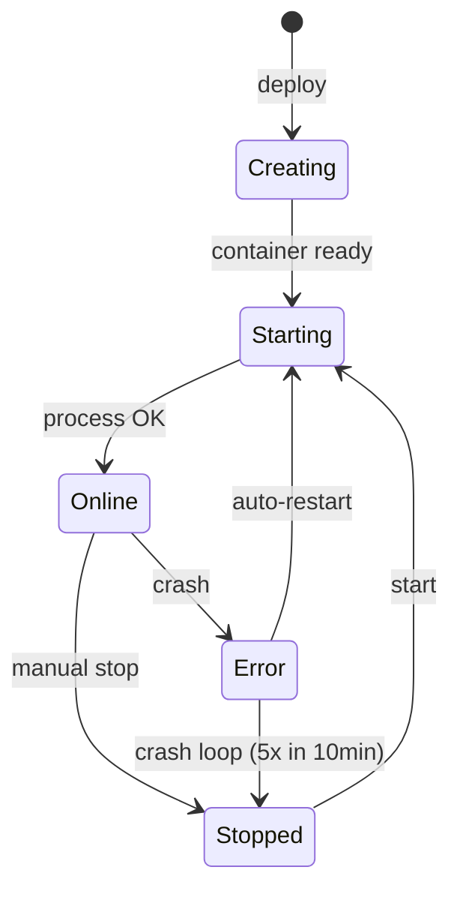

## ¿Qué es una aplicación en Vertra Cloud?

Una aplicación en Vertra Cloud es tu código ejecutándose en un contenedor aislado, con memoria y
almacenamiento dedicados y, cuando se publica en la web, un subdominio exclusivo `*.vertraweb.app` por
HTTPS. Vertra Cloud es una plataforma brasileña de alojamiento de aplicaciones (PaaS), y la aplicación es
la unidad que despliega, reinicia, genera snapshots y factura según la RAM de tu plan.

## ¿Qué tipos de aplicación hay?

Dos: **sitio**, que escucha en un puerto HTTP y recibe un subdominio, y **bot**, un proceso en segundo
plano sin puerto expuesto. El tipo no se fija al crear la aplicación: publicarla o despublicarla lo cambia.

<Tabs>
  <Tab title="Sitio">
    Aplicaciones web accesibles por HTTP/HTTPS. Reciben un subdominio y pueden tener un dominio personalizado.

    Ejemplos: APIs REST, aplicaciones Next.js, sitios dinámicos, paneles.
  </Tab>
  <Tab title="Bot">
    Aplicaciones que se ejecutan en segundo plano sin exponer un puerto HTTP. Ideales para bots de Discord, automatizaciones y workers.

    Ejemplos: bots de Discord, bots de Telegram, cron jobs, workers de colas.
  </Tab>
</Tabs>

El tipo no es permanente. Una aplicación creada sin publicación web se puede publicar más adelante, y una
publicada puede volver a ser una aplicación privada, desde la configuración de **Red** de la aplicación o
mediante [Publicar aplicación en la web](/api-reference/endpoint/apps/network/publish).

<Warning>
  Activar o desactivar la publicación **recrea el contenedor, así que la aplicación se reinicia**. Y despublicar
  **libera el subdominio**: no queda reservado para ti, así que otra persona puede registrarlo.
</Warning>

## Lenguajes compatibles

La plataforma admite el despliegue de aplicaciones en varios lenguajes. El entorno de ejecución se configura
automáticamente según el lenguaje seleccionado.

<CardGroup cols={3}>
  <Card title="JavaScript" icon="js">
    Node.js 22, 24 con npm/yarn
  </Card>
  <Card title="TypeScript" icon="js">
    Node.js 22, 24 mediante ts-node
  </Card>
  <Card title="Python" icon="python">
    3.11, 3.12, 3.13 con pip
  </Card>
  <Card title="Go" icon="golang">
    1.26, 1.27 con go mod
  </Card>
  <Card title="Rust" icon="rust">
    1.99 con cargo
  </Card>
  <Card title="Java" icon="java">
    17, 21 con maven/gradle
  </Card>
  <Card title="PHP" icon="php">
    8.2, 8.3, 8.4 con composer
  </Card>
  <Card title="Ruby" icon="gem">
    3.3, 3.4 con bundler
  </Card>
  <Card title="Bun" icon="bolt">
    1.3, 1.4
  </Card>
  <Card title="Deno" icon="code">
    2.8, 2.9 con deno.json
  </Card>
  <Card title=".NET (C#)" icon="code">
    10.0 con dotnet publish
  </Card>
  <Card title="Elixir" icon="code">
    1.20 (OTP 28) con mix, compatible con Phoenix
  </Card>
  <Card title="Static" icon="file-code">
    HTML, CSS, JavaScript puro
  </Card>
</CardGroup>

<Info>
  La plataforma detecta el lenguaje a partir de los archivos de manifiesto en la raíz del proyecto. Para forzar
  uno, define `LANGUAGE=<slug>` en [`vertracloud.config`](/es-es/configuration) o envía `language` al
  [crear la aplicación](/api-reference/endpoint/apps/create).
</Info>

<Info>
  Las versiones disponibles provienen de [Listar runtimes](/api-reference/endpoint/apps/runtimes). Usa
  `recommended` para la versión estable, `latest` para la más reciente, o fija una de las versiones listadas
  por su número. Una versión que no existe para el lenguaje de la aplicación se rechaza con `INVALID_VERSION`.
</Info>

## Ciclo de vida



Una aplicación pasa por los siguientes estados:

| Estado | Descripción | Icono |
|-------|-----------|:-----:|
| **Creando** (`building`) | La aplicación fue aceptada y su instalación y build se ejecutan en segundo plano; la mayoría de acciones responden `409 APP_BUILDING` hasta que termina como `up` o `down` | ↻ |
| **Iniciando** | Contenedor creado, proceso de arranque en curso | ... |
| **En línea** | Aplicación en ejecución y accesible | ● |
| **Detenida** | Detenida manualmente | ○ |
| **Error** | El contenedor encontró un error durante la ejecución | ! |

## Comando de build

El campo opcional `build_command`, disponible en todos los planes, se ejecuta después de instalar las
dependencias y antes de que la aplicación arranque, en cada despliegue que instala o cambia código: creación,
subida de ZIP, despliegue desde GitHub, reinstalación de dependencias o cambio del propio comando. Un reinicio
normal lo omite cuando el build anterior ya terminó con éxito usando el mismo comando.

El build se ejecuta en un entorno de build aislado: 2× la RAM de la aplicación (mínimo 1.024 MB, máximo
4.096 MB), con un timeout de 10 minutos. Con un comando de build, las `devDependencies` también se instalan.
Un comando que falla hace fallar el despliegue (`BUILD_FAILED`); superar el timeout también (`BUILD_TIMEOUT`).
Una aplicación nueva se sigue creando, detenida, para que puedas leer la salida del build en sus logs,
corregirla y volver a arrancarla.

| Framework | Build | Start |
|---|---|---|
| Next.js | `npm run build` | `npx next start -p 80` |
| Nuxt | `npm run build` | `PORT=80 node .output/server/index.mjs` |
| SvelteKit (adapter-node) | `npm run build` | `PORT=80 node build` |
| Remix | `npm run build` | `npx remix-serve build/server/index.js` |
| React Router v7 | `npm run build` | `npx react-router-serve ./build/server/index.js` |
| Astro | `npm run build` | `npx astro preview --host 0.0.0.0 --port 80` |
| Gatsby | `npm run build` | `npx gatsby serve --host 0.0.0.0 -p 80` |
| Vite | `npm run build` | `npx vite preview --host 0.0.0.0 --port 80` |

Las aplicaciones deben escuchar en el **puerto 80**. Al crear una aplicación desde un ZIP en el panel, la
plataforma sugiere los comandos de build y de arranque anteriores a partir de las dependencias declaradas en
`package.json` (Next.js, Nuxt, SvelteKit, Remix, React Router, Astro, Gatsby y Vite); puedes editar ambos
antes de crear la aplicación.

## Archivo de configuración

Un archivo opcional `vertracloud.config` (`KEY=value`, uno por línea) en la raíz del ZIP subido rellena
previamente el flujo de creación: `NAME`, `DESCRIPTION`, `MAIN`, `MEMORY`, `BUILD`, `START` y `SUBDOMAIN`.
La configuración real está en el panel (pestaña **Ajustes**). El archivo no se guarda en el volumen de la
aplicación; se genera a partir de tu configuración actual cuando descargas el proyecto o creas un snapshot.
Cada clave, sus límites y lo que se puede cambiar después están en [Configuración](/es-es/configuration).

## Gestor de archivos

El panel incluye un gestor de archivos integrado, con resaltado de sintaxis y edición de código, que permite:

<AccordionGroup>
  <Accordion title="Navegación y edición" icon="folder-open">
    - Árbol de archivos de hasta 6 niveles de profundidad
    - Resaltado de sintaxis para todos los lenguajes compatibles
    - Crear, editar, mover y eliminar archivos y carpetas
  </Accordion>
  <Accordion title="Subida de archivos" icon="upload">
    - Arrastrar y soltar archivos individuales o un ZIP
    - Validación automática de archivos y directorios
    - Extracción automática de archivos ZIP
  </Accordion>
</AccordionGroup>

En el diálogo **Subir cambios**, el campo **Destino del commit** empieza con la carpeta que tengas abierta en
el gestor de archivos. Usa **Seleccionar** para elegir cualquier otra carpeta de la aplicación. Los archivos se
escriben en esa carpeta, y un ZIP se extrae dentro de ella, combinado con los archivos que ya existan allí en
lugar de reemplazar la carpeta. La API acepta la misma elección mediante el parámetro de consulta `path` de
[Subir archivos a la aplicación](/api-reference/endpoint/apps/filemanager/upload).

## Variables de entorno

Las variables de entorno se inyectan en el contenedor al arrancar y quedan disponibles como variables del
sistema. Gestiónalas desde el panel o la API.

<Tabs>
  <Tab title="Desde el panel">
    Accede a la aplicación → **Variables de Entorno** → añade, edita o elimina variables.
  </Tab>
  <Tab title="Desde la API">
    ```bash
    curl -H "Authorization: Bearer $VERTRA_API_KEY" \
         https://api.vertracloud.app/v1/apps/{id}/envs

    curl -X POST -H "Authorization: Bearer $VERTRA_API_KEY" \
         -H "Content-Type: application/json" \
         -d '[{"key":"DATABASE_URL","value":"..."}]' \
         https://api.vertracloud.app/v1/apps/{id}/envs
    ```
  </Tab>
</Tabs>

## Snapshots

Los snapshots son copias del estado de tu aplicación en un momento concreto. Permiten crear snapshots manuales,
restaurar snapshots anteriores y descargar el contenido de cualquier snapshot.

<Warning>
  La restauración de snapshots tiene un periodo de espera entre operaciones para evitar un uso excesivo de recursos.
</Warning>

## Dominio personalizado

Cada aplicación publicada recibe un subdominio por defecto (por ejemplo, `my-app.vertraweb.app`). También
puedes conectar tus propios dominios con SSL automático, tantos como permita tu plan. Añadir o cambiar un
dominio nunca reinicia la aplicación. Despublicar la aplicación elimina sus dominios personalizados junto con
el subdominio; después, borra los registros `CNAME` y `TXT` en tu proveedor de DNS.

<Steps>
  <Step title="Añadir dominio">
    En la pestaña **Red** de la aplicación, añade el dominio. El dominio raíz o `www` se añade junto con su
    complemento automático.
  </Step>
  <Step title="Configurar DNS">
    Configura los registros DNS tal como indica el panel.
  </Step>
  <Step title="Verificación y SSL">
    La plataforma verifica la configuración del DNS y provisiona el certificado SSL automáticamente.
  </Step>
</Steps>

Cada dominio puede usar un puerto, un prefijo de ruta o una redirección propios. Consulta
[Conectar dominios personalizados](/es-es/guides/custom-domain).

<Note>
  Los dominios personalizados están disponibles desde el plan **Intermediary** (1 dominio por aplicación); los
  niveles Enterprise superiores permiten hasta 20. El `www` automático no cuenta.
</Note>

## Reinicio automático y detección de fallos

El reinicio automático está **activado por defecto en todos los planes**: no hay interruptor ni nada que configurar:

<AccordionGroup>
  <Accordion title="Cómo funciona el reinicio automático" icon="rotate">
    - Los contenedores que terminan de forma inesperada se reinician automáticamente
    - Los códigos de salida normales (0) y los errores de sintaxis o de dependencias **no** activan el reinicio
    - Se aplica un intervalo de 1 hora entre reinicios consecutivos
    - El contenedor debe estar en línea al menos 60 segundos para contar como estable
  </Accordion>
  <Accordion title="Detección de crash loop" icon="shield">
    - Si un contenedor falla **5 veces en 10 minutos**, el reinicio automático se desactiva durante 24 horas
    - El sistema registra el motivo de la parada por reinicio automático
    - Pasadas 24 horas, el reinicio automático se reanuda solo
  </Accordion>
</AccordionGroup>

## Logs en tiempo real

La terminal del panel muestra la salida de la aplicación en directo; cuando la aplicación está detenida, muestra
los logs más recientes. Desde fuera del panel, usa `vertra logs -f` en la [CLI](/es-es/cli) o consulta
[Logs de la aplicación](/api-reference/endpoint/apps/logs).

## Métricas

El panel muestra métricas de rendimiento en tiempo real:

<CardGroup cols={3}>
  <Card title="CPU" icon="microchip">
    Porcentaje de uso de CPU del contenedor en tiempo real.
  </Card>
  <Card title="Memoria" icon="memory">
    Consumo actual de RAM frente al límite asignado.
  </Card>
  <Card title="Red" icon="network-wired">
    Bytes recibidos y enviados, con el total acumulado.
  </Card>
</CardGroup>
