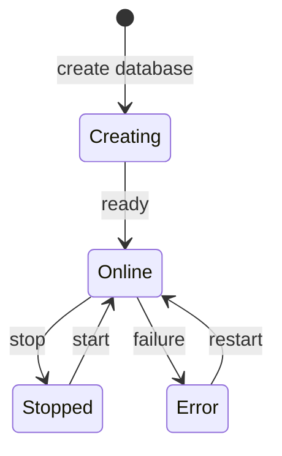

## ¿Qué es una base de datos gestionada en Vertra Cloud?

Una base de datos gestionada en Vertra Cloud es una instancia de PostgreSQL, MongoDB, Redis o MySQL que la
plataforma aprovisiona, protege y monitoriza por ti: TLS es obligatorio, los certificados de CA, de servidor
y de cliente se generan automáticamente, y cada base de datos se ejecuta en su propio contenedor, con memoria
y almacenamiento dedicados.

## ¿Qué motores de base de datos están disponibles?

Cuatro: PostgreSQL (18 o 17), MongoDB (8.0 o 9.0), Redis (8.2 o 7.2) y MySQL (9.7 u 8.4). Eliges la versión
al crear la base de datos, y la recomendada es la predeterminada. Todos los motores exigen TLS **y un
certificado de cliente**: una contraseña sola nunca conecta.

<CardGroup cols={2}>
  <Card title="PostgreSQL 18 / 17" icon="elephant">
    Base de datos relacional con SQL completo, compatibilidad con JSONB y extensiones.

    **Usuario**: `vertracloud` &nbsp;|&nbsp; **Base de datos**: `vertracloud` &nbsp;|&nbsp; **Autenticación**: contraseña + certificado de cliente
  </Card>
  <Card title="MongoDB 8.0 / 9.0" icon="leaf">
    Base de datos NoSQL orientada a documentos, para datos flexibles.

    **Usuario**: `vertracloud` &nbsp;|&nbsp; **Base de datos**: `vertracloud` &nbsp;|&nbsp; **Base de datos de autenticación**: `admin` &nbsp;|&nbsp; **Autenticación**: contraseña + certificado de cliente
  </Card>
  <Card title="Redis 8.2 / 7.2" icon="bolt">
    Almacenamiento en memoria para caché de alto rendimiento, colas y pub/sub.

    **Usuario**: `vertracloud` &nbsp;|&nbsp; **Autenticación**: usuario + contraseña + certificado de cliente
  </Card>
  <Card title="MySQL 9.7 / 8.4" icon="database">
    Base de datos relacional muy extendida, con transacciones ACID y un gran ecosistema.

    **Usuario**: `vertracloud` &nbsp;|&nbsp; **Base de datos**: `vertracloud` &nbsp;|&nbsp; **Autenticación**: contraseña + certificado de cliente X509
  </Card>
</CardGroup>

## ¿Con qué usuario me conecto?

Las bases de datos creadas a partir de la [v26.4.8](/es-es/changelog/v26-4-8) te dan el usuario `vertracloud`
y una base de datos predeterminada llamada `vertracloud`. Es propietario de tus datos y, según el motor, puede
crear bases de datos y roles (PostgreSQL), usar todas las bases de datos (MongoDB) o ejecutar todos los
comandos de datos (Redis). Como en otros servicios de bases de datos gestionadas, la administración a nivel de
servidor (ajustes del servidor, usuarios administradores, copias de seguridad y restauraciones) la gestiona la
plataforma.

Las bases de datos creadas antes conservan el usuario por defecto del motor: `postgres` (base de datos
`postgres`) en PostgreSQL, `default` en MongoDB y Redis, y `root` (base de datos `default`) en MySQL. El campo
`username` de [Obtener base de datos](/es-es/api-reference/endpoint/databases/get) siempre indica cuál usar.

## ¿Qué necesito para conectarme?

Cuatro datos, todos en la página de la base de datos del panel (o a través de la API):

- **Host** — `<id-de-la-base-de-datos-sin-guiones>.db.usa1.vertraweb.app`, visible en la página de la base de
  datos y en [Obtener base de datos](/es-es/api-reference/endpoint/databases/get).
- **Puerto** — **único por base de datos**, no el puerto por defecto del motor (5432, 27017, 6379, 3306).
  Cópialo siempre desde la página de la base de datos o desde la respuesta de la API.
- **Usuario** — `vertracloud` (o el usuario del motor en bases de datos antiguas), visible en la página de la
  base de datos y como `username` en [Obtener base de datos](/es-es/api-reference/endpoint/databases/get).
- **Contraseña** — visible en la página de la base de datos; [restablécela](/es-es/api-reference/endpoint/databases/credentials/resetpassword)
  si es necesario.
- **Certificados** — descárgalos en la pestaña **Certificados** de la base de datos o mediante
  [Obtener certificado de base de datos](/es-es/api-reference/endpoint/databases/credentials/get):

| Archivo | Qué es | Úsalo como |
|---|---|---|
| `certificate-<id>.ca.pem` | La CA que firma el certificado de servidor de la base de datos | archivo de CA (`ca`, `sslrootcert`, `--cacert`, `tlsCAFile`, `--ssl-ca`) |
| `certificate-<id>.crt` | Tu certificado de cliente — **no** es la CA | certificado de cliente (`cert`, `sslcert`, `--cert`, `--ssl-cert`) |
| `certificate-<id>.key` | Tu clave privada de cliente | clave de cliente (`key`, `sslkey`, `--key`, `--ssl-key`) |
| `certificate-<id>.pem` | Paquete: clave de cliente + certificado de cliente + la CA, en ese orden | archivo de certificado con clave de MongoDB (`tlsCertificateKeyFile`) |
| `certificate-<id>.p12` | Tu clave y tu certificado de cliente en PKCS#12, contraseña vacía | drivers que solo aceptan una identidad PKCS#12, como [Prisma 6](#cómo-me-conecto-con-prisma-6) |

La mayoría de las conexiones necesitan tres: `.ca.pem`, `.crt` y `.key`. Es posible que las bases de datos
antiguas no ofrezcan el `.ca.pem`; en ellas, usa el `.pem` como archivo de CA, ya que la CA es su última parte.

El certificado del servidor coincide con el host de la base de datos, así que funciona la verificación completa
(`verify-full`, `VERIFY_IDENTITY`, `rejectUnauthorized: true`). Mantén los archivos `.key`, `.pem` y `.p12` en privado:
se autentican como tú. [Restablecer los certificados](/es-es/api-reference/endpoint/databases/credentials/reset)
emite otros nuevos e invalida los archivos antiguos.

## ¿Cómo me conecto a cada motor?

En los ejemplos, `<host>`, `<port>` y `<password>` proceden de la página de la base de datos; el usuario y la
base de datos son `vertracloud` (sustitúyelo por el `username` de tu base de datos si se creó antes de la
v26.4.8), y `certificate.ca.pem` / `certificate.crt` / `certificate.key` / `certificate.pem` son los archivos descargados.

<Tabs>
  <Tab title="PostgreSQL">
    ```javascript Node.js (pg)
    const { Pool } = require('pg');
    const fs = require('fs');

    const pool = new Pool({
      host: '<host>',
      port: <port>,
      user: 'vertracloud',
      password: '<password>',
      database: 'vertracloud',
      ssl: {
        ca: fs.readFileSync('certificate.ca.pem'),
        cert: fs.readFileSync('certificate.crt'),
        key: fs.readFileSync('certificate.key'),
        rejectUnauthorized: true,
      },
    });
    ```

    ```python Python (psycopg)
    import psycopg

    conn = psycopg.connect(
        host="<host>", port=<port>, user="vertracloud", password="<password>", dbname="vertracloud",
        sslmode="verify-full", sslrootcert="certificate.ca.pem",
        sslcert="certificate.crt", sslkey="certificate.key",
    )
    ```

    ```bash psql
    psql "host=<host> port=<port> dbname=vertracloud user=vertracloud password=<password> sslmode=verify-full sslrootcert=certificate.ca.pem sslcert=certificate.crt sslkey=certificate.key"
    ```
  </Tab>
  <Tab title="MongoDB">
    El usuario está en la base de datos `admin`, así que la URI siempre necesita `authSource=admin`.

    ```javascript Node.js (mongodb)
    const { MongoClient } = require('mongodb');

    const client = new MongoClient('mongodb://vertracloud:<password>@<host>:<port>/vertracloud?authSource=admin', {
      tls: true,
      tlsCAFile: 'certificate.ca.pem',
      tlsCertificateKeyFile: 'certificate.pem',
    });
    ```

    ```bash mongosh
    mongosh "mongodb://vertracloud:<password>@<host>:<port>/vertracloud?authSource=admin" --tls --tlsCAFile certificate.ca.pem --tlsCertificateKeyFile certificate.pem
    ```
  </Tab>
  <Tab title="Redis">
    ```javascript Node.js (ioredis)
    const Redis = require('ioredis');
    const fs = require('fs');

    const redis = new Redis({
      host: '<host>',
      port: <port>,
      username: 'vertracloud',
      password: '<password>',
      tls: {
        servername: '<host>',
        ca: fs.readFileSync('certificate.ca.pem'),
        cert: fs.readFileSync('certificate.crt'),
        key: fs.readFileSync('certificate.key'),
      },
    });
    ```

    ```bash redis-cli
    redis-cli -h <host> -p <port> --user vertracloud -a <password> --tls --cacert certificate.ca.pem --cert certificate.crt --key certificate.key
    ```
  </Tab>
  <Tab title="MySQL">
    ```javascript Node.js (mysql2)
    const mysql = require('mysql2/promise');
    const fs = require('fs');

    const connection = await mysql.createConnection({
      host: '<host>',
      port: <port>,
      user: 'vertracloud',
      password: '<password>',
      database: 'vertracloud',
      ssl: {
        ca: fs.readFileSync('certificate.ca.pem'),
        cert: fs.readFileSync('certificate.crt'),
        key: fs.readFileSync('certificate.key'),
      },
    });
    ```

    ```bash mysql
    mysql -h <host> -P <port> -u vertracloud -p vertracloud --ssl-mode=VERIFY_IDENTITY --ssl-ca=certificate.ca.pem --ssl-cert=certificate.crt --ssl-key=certificate.key
    ```
  </Tab>
</Tabs>

<Warning>
  Una conexión solo con la contraseña —o con TLS pero sin el certificado de cliente— la rechazan todos los
  motores. La mayoría de los errores de "connection refused" o "handshake failed" se deben a un `.crt`/`.key`
  que falta, o a usar el puerto por defecto del motor en lugar del puerto propio de la base de datos.
</Warning>

### ¿Por qué falla la conexión con mi base de datos?

Casi todos los fallos son una de tres cosas: el puerto equivocado, un archivo de certificado en el lugar
equivocado o el usuario equivocado. Busca abajo el mensaje que recibiste; los ejemplos vienen de Node.js
(`pg`), y otros drivers describen la misma causa con otras palabras.

| Mensaje de error | Causa | Solución |
|---|---|---|
| `ECONNREFUSED` / `ETIMEDOUT` / `Connection refused` | Puerto equivocado (el del motor por defecto en lugar del puerto propio de la base de datos) o la base de datos no está **En línea** | Copia el puerto desde la página de la base de datos y comprueba el estado |
| `self-signed certificate in certificate chain` (`SELF_SIGNED_CERT_IN_CHAIN`), `certificate verify failed` | Falta la CA o es el archivo equivocado — normalmente el `.crt` pasado como CA | Pasa el `.ca.pem` como CA (`ca`, `sslrootcert`, `--cacert`) |
| `key values mismatch` (`ERR_OSSL_X509_KEY_VALUES_MISMATCH`) | El certificado de cliente y la clave no son pareja: archivos intercambiados (el `.ca.pem` pasado como certificado), de bases de datos distintas o de antes de un restablecimiento de certificados | Usa el `.crt` y el `.key` de la misma descarga |
| `connection requires a valid client certificate` | TLS está activado, pero no se enviaron el certificado de cliente ni la clave | Añade el `.crt` y el `.key` (`cert`/`key`, `sslcert`/`sslkey`) |
| `pg_hba.conf rejects connection ... no encryption` | TLS está desactivado | Activa TLS con los tres archivos; una conexión sin TLS siempre se rechaza |
| `pg_hba.conf rejects connection ... user "postgres"` | Usuario equivocado: las bases de datos creadas desde la v26.4.8 usan `vertracloud` | Usa el usuario que aparece en la página de la base de datos (`username` en la API) |
| `password authentication failed for user` | Contraseña equivocada, o cambió tras **Restablecer Contraseña** | Copia de nuevo la contraseña y reinicia la aplicación |
| `Hostname/IP does not match certificate's altnames` | Conexión por dirección IP o por otro nombre | Conéctate con el host que aparece en la página de la base de datos |
| `ENOENT: no such file or directory` | La ruta del certificado no existe donde se ejecuta el proceso | Las rutas son relativas al directorio de trabajo; comprueba que los archivos se desplegaron |
| `Error opening a TLS connection` (Prisma `P1011`) | Las mismas causas que las filas de certificados anteriores | Consulta [Prisma 6](#cómo-me-conecto-con-prisma-6) |

Situaciones que provocan estos errores sin un motivo evidente:

- **`sslmode` en la URL anula el objeto `ssl` (Node.js `pg`, Drizzle).** Cuando pasas una
  `connectionString` con `?sslmode=require` y además un objeto `ssl: { ca, cert, key }`, gana la URL y
  se ignoran los archivos, así que recibes `self-signed certificate in certificate chain` aunque los
  archivos sean los correctos. Usa uno u otro: el objeto `ssl` con una URL sin `sslmode`, o una URL que lo
  lleve todo (`?sslmode=verify-full&sslrootcert=certificate.ca.pem&sslcert=certificate.crt&sslkey=certificate.key`).
- **`rejectUnauthorized: "false"` (una cadena) no desactiva la verificación.** Solo lo hace el booleano
  `false`, y no deberías usarlo: con el `.ca.pem`, la verificación completa funciona.
- **Certificados en una variable de entorno.** Un PEM pegado en una variable de una sola línea suele
  llegar con `\n` literales y no se lee como certificado. Guarda los archivos en el proyecto y apunta
  las variables a sus rutas.
- **`psql` rechaza el archivo de la clave.** libpq exige que el `.key` sea legible solo por ti; ejecuta
  `chmod 600 certificate.key` después de descargarlo.
- **Tras Restablecer Certificado, todo falla a la vez.** La CA, el certificado de cliente y la clave
  cambian: descarga los archivos nuevos, sustitúyelos todos y reinicia la aplicación.
- **Funciona en local, falla en la aplicación.** La carpeta `certs/` no se desplegó (a menudo está en
  `.gitignore`), o las variables de entorno se añadieron sin reiniciar la aplicación.

### Certificados en aplicaciones ligadas a una stack

Cuando una aplicación y una base de datos se despliegan juntas desde una [plantilla](/es-es/templates/use/stacks), la plataforma escribe los certificados de la base de datos en la aplicación por ti, en `/app/.vertra/certs/<database_id>/`: `ca.pem`, `client.crt`, `client.key`, `client.pem` (MongoDB) y `client.p12` (Prisma). Variables como la URL de conexión apuntan a esas rutas, así que no subes nada. Consulta [Conectar bases de datos](/es-es/templates/use/connect-databases).

### ¿Cómo me conecto con Prisma 6?

Prisma 6 solo acepta un certificado de cliente como identidad PKCS#12, así que usa el archivo `client.p12` (cifrado con AES, contraseña vacía, por lo que no hace falta `sslpassword`) en `sslidentity` y la CA en `sslcert`:

```ini
DATABASE_URL=postgresql://vertracloud:<password>@<host>:<port>/vertracloud?sslmode=require&sslaccept=strict&sslcert=/app/.vertra/certs/<database_id>/ca.pem&sslidentity=/app/.vertra/certs/<database_id>/client.p12
```

Una plantilla puede pedir esta URL ya preparada, pero nunca se añade a una conexión por defecto, porque lleva la contraseña. Fuera de una stack, usa el `certificate-<id>.ca.pem` descargado en `sslcert` y el `certificate-<id>.p12` en `sslidentity`. Prisma 7 lee los archivos PEM desde la URL estándar de PostgreSQL y no necesita el `.p12`.

### ¿Cómo me conecto con Drizzle?

Drizzle ORM usa tu driver (`pg`), así que pasa el objeto `ssl` del ejemplo de PostgreSQL. Drizzle Kit
(`drizzle-kit migrate`, `push`, `pull` y `studio`) lee `drizzle.config.ts`, donde el objeto `ssl`
solo vale con credenciales `host`/`port`, no con `url`. La configuración completa, incluido Drizzle Studio,
está en [Conectar una base de datos](/es-es/guides/connect-database#usa-drizzle-kit-y-drizzle-studio).

### ¿Se conecta Python 3.13 a la base de datos?

Sí, pero Python 3.13 y posteriores activan comprobaciones X.509 estrictas en el contexto TLS por defecto (`ssl.create_default_context()`), y las bases de datos creadas antes de la corrección de los certificados pueden fallar con `Missing Authority Key Identifier`. Se ven afectadas las librerías que usan el contexto por defecto, como redis-py y pg8000; psycopg, asyncpg, PyMySQL y pymongo no. Las bases de datos nuevas y aquellas cuyos certificados has restablecido ya emiten certificados compatibles. Si no puedes restablecer ahora, redis-py 6 o superior acepta `ssl_exclude_verify_flags=[ssl.VERIFY_X509_STRICT]`.

### ¿Qué ocurre al restablecer los certificados?

El restablecimiento emite una CA, un certificado de servidor y uno de cliente nuevos, e invalida los archivos antiguos. En las aplicaciones ligadas a una stack, los archivos de `/app/.vertra/certs/` se reescriben automáticamente, pero el proceso en ejecución aún conserva los antiguos: la respuesta indica `restart_required` y lista las aplicaciones que hay que reiniciar. Los archivos que descargaste y colocaste tú en un proyecto deben descargarse y desplegarse de nuevo.

## Ciclo de vida



| Estado | Descripción | Indicador |
|-------|-----------|:---------:|
| **Creando** | Contenedor en aprovisionamiento con certificados TLS | ↻ |
| **En línea** | Base de datos en ejecución y aceptando conexiones | ● |
| **Detenida** | Detenida manualmente (datos conservados) | ○ |
| **Error** | Problema durante la inicialización o la ejecución | ! |

## Operaciones disponibles

<CardGroup cols={2}>
  <Card title="Iniciar / Detener / Reiniciar" icon="play">
    Controla el ciclo de vida del contenedor. Los datos se conservan al detener o reiniciar.
  </Card>
  <Card title="Restablecer" icon="trash">
    Borra todos los datos y recrea la base de datos desde cero. **Acción irreversible.**
  </Card>
  <Card title="Restablecer contraseña" icon="key">
    Genera una contraseña nueva, aleatoria y segura, para la base de datos.
  </Card>
  <Card title="Restablecer certificados" icon="certificate">
    Regenera todos los certificados TLS (CA, servidor y cliente).
  </Card>
  <Card title="Descargar snapshot" icon="download">
    Descarga una copia de los datos de la base de datos.
  </Card>
  <Card title="Restaurar snapshot" icon="clock-rotate-left">
    Restaura la base de datos a partir de un snapshot anterior.
  </Card>
</CardGroup>

<Warning>
  La operación **Restablecer** es destructiva y borra todos los datos de la base de datos. Esta acción no se puede deshacer.
</Warning>

## Métricas

El panel muestra métricas en tiempo real para cada base de datos:

<CardGroup cols={3}>
  <Card title="CPU" icon="microchip">
    Uso de CPU del contenedor.
  </Card>
  <Card title="Memoria" icon="memory">
    Consumo actual de RAM.
  </Card>
  <Card title="Almacenamiento" icon="hard-drive">
    Espacio de disco usado frente a la cuota.
  </Card>
</CardGroup>

## Almacenamiento

El almacenamiento de las bases de datos tiene límites estrictos aplicados a nivel de contenedor, lo que garantiza
que una base de datos no pueda consumir más espacio del que tiene asignado.
