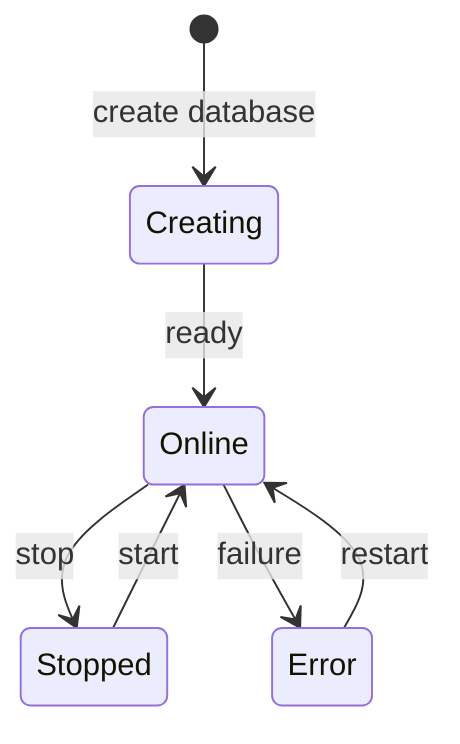

## ¿Qué es una base de datos gestionada en Vertra Cloud?

Una base de datos gestionada en Vertra Cloud es una instancia de PostgreSQL, MongoDB, Redis o MySQL que la
plataforma aprovisiona, protege y monitoriza por ti: TLS es obligatorio, los certificados de CA, de servidor
y de cliente se generan automáticamente, y cada base de datos se ejecuta en su propio contenedor, con memoria
y almacenamiento dedicados.

## ¿Qué motores de base de datos están disponibles?

Cuatro: PostgreSQL (18 o 17), MongoDB (8.0 o 9.0), Redis (8.2 o 7.2) y MySQL (9.7 u 8.4). Eliges la versión
al crear la base de datos, y la recomendada es la predeterminada. Todos los motores exigen TLS **y un
certificado de cliente**: una contraseña sola nunca conecta.

<CardGroup cols={2}>
  <Card title="PostgreSQL 18 / 17" icon="elephant">
    Base de datos relacional con SQL completo, compatibilidad con JSONB y extensiones.

    **Usuario**: `vertracloud` &nbsp;|&nbsp; **Base de datos**: `vertracloud` &nbsp;|&nbsp; **Autenticación**: contraseña + certificado de cliente
  </Card>
  <Card title="MongoDB 8.0 / 9.0" icon="leaf">
    Base de datos NoSQL orientada a documentos, para datos flexibles.

    **Usuario**: `vertracloud` &nbsp;|&nbsp; **Base de datos**: `vertracloud` &nbsp;|&nbsp; **Base de datos de autenticación**: `admin` &nbsp;|&nbsp; **Autenticación**: contraseña + certificado de cliente
  </Card>
  <Card title="Redis 8.2 / 7.2" icon="bolt">
    Almacenamiento en memoria para caché de alto rendimiento, colas y pub/sub.

    **Usuario**: `vertracloud` &nbsp;|&nbsp; **Autenticación**: usuario + contraseña + certificado de cliente
  </Card>
  <Card title="MySQL 9.7 / 8.4" icon="database">
    Base de datos relacional muy extendida, con transacciones ACID y un gran ecosistema.

    **Usuario**: `vertracloud` &nbsp;|&nbsp; **Base de datos**: `vertracloud` &nbsp;|&nbsp; **Autenticación**: contraseña + certificado de cliente X509
  </Card>
</CardGroup>

## ¿Con qué usuario me conecto?

Las bases de datos creadas a partir de la [v26.4.8](/es-es/changelog/v26-4-8) te dan el usuario `vertracloud`
y una base de datos predeterminada llamada `vertracloud`. Es propietario de tus datos y, según el motor, puede
crear bases de datos y roles (PostgreSQL), usar todas las bases de datos (MongoDB) o ejecutar todos los
comandos de datos (Redis). Como en otros servicios de bases de datos gestionadas, la administración a nivel de
servidor (ajustes del servidor, usuarios administradores, copias de seguridad y restauraciones) la gestiona la
plataforma.

Las bases de datos creadas antes conservan el usuario por defecto del motor: `postgres` (base de datos
`postgres`) en PostgreSQL, `default` en MongoDB y Redis, y `root` (base de datos `default`) en MySQL. El campo
`username` de [Obtener base de datos](/api-reference/endpoint/databases/get) siempre indica cuál usar.

## ¿Qué necesito para conectarme?

Cuatro datos, todos en la página de la base de datos del panel (o a través de la API):

- **Host** — `<id-de-la-base-de-datos-sin-guiones>.db.usa1.vertraweb.app`, visible en la página de la base de
  datos y en [Obtener base de datos](/api-reference/endpoint/databases/get).
- **Puerto** — **único por base de datos**, no el puerto por defecto del motor (5432, 27017, 6379, 3306).
  Cópialo siempre desde la página de la base de datos o desde la respuesta de la API.
- **Usuario** — `vertracloud` (o el usuario del motor en bases de datos antiguas), visible en la página de la
  base de datos y como `username` en [Obtener base de datos](/api-reference/endpoint/databases/get).
- **Contraseña** — visible en la página de la base de datos; [restablécela](/api-reference/endpoint/databases/credentials/resetpassword)
  si es necesario.
- **Certificados** — descárgalos en la pestaña **Certificados** de la base de datos o mediante
  [Obtener certificado de base de datos](/api-reference/endpoint/databases/credentials/get):

| Archivo | Qué es | Úsalo como |
|---|---|---|
| `certificate-<id>.crt` | Tu certificado de cliente | certificado de cliente (`cert`, `sslcert`, `--cert`) |
| `certificate-<id>.key` | Tu clave privada de cliente | clave de cliente (`key`, `sslkey`, `--key`) |
| `certificate-<id>.pem` | Paquete: clave de cliente + certificado de cliente + la CA que firma el servidor | archivo de CA (`ca`, `sslrootcert`, `--cacert`) y, en MongoDB, el archivo de certificado con clave |

El certificado del servidor coincide con el host de la base de datos, así que funciona la verificación completa
(`verify-full`, `VERIFY_IDENTITY`, `rejectUnauthorized: true`). Mantén los archivos `.key` y `.pem` en privado:
se autentican como tú. [Restablecer los certificados](/api-reference/endpoint/databases/credentials/reset)
emite otros nuevos e invalida los archivos antiguos.

## ¿Cómo me conecto a cada motor?

En los ejemplos, `<host>`, `<port>` y `<password>` proceden de la página de la base de datos; el usuario y la
base de datos son `vertracloud` (sustitúyelo por el `username` de tu base de datos si se creó antes de la
v26.4.8), y `certificate.crt` / `certificate.key` / `certificate.pem` son los tres archivos descargados.

<Tabs>
  <Tab title="PostgreSQL">
    ```javascript Node.js (pg)
    const { Pool } = require('pg');
    const fs = require('fs');

    const pool = new Pool({
      host: '<host>',
      port: <port>,
      user: 'vertracloud',
      password: '<password>',
      database: 'vertracloud',
      ssl: {
        ca: fs.readFileSync('certificate.pem'),
        cert: fs.readFileSync('certificate.crt'),
        key: fs.readFileSync('certificate.key'),
        rejectUnauthorized: true,
      },
    });
    ```

    ```python Python (psycopg)
    import psycopg

    conn = psycopg.connect(
        host="<host>", port=<port>, user="vertracloud", password="<password>", dbname="vertracloud",
        sslmode="verify-full", sslrootcert="certificate.pem",
        sslcert="certificate.crt", sslkey="certificate.key",
    )
    ```

    ```bash psql
    psql "host=<host> port=<port> dbname=vertracloud user=vertracloud password=<password> sslmode=verify-full sslrootcert=certificate.pem sslcert=certificate.crt sslkey=certificate.key"
    ```
  </Tab>
  <Tab title="MongoDB">
    El usuario está en la base de datos `admin`, así que la URI siempre necesita `authSource=admin`.

    ```javascript Node.js (mongodb)
    const { MongoClient } = require('mongodb');

    const client = new MongoClient('mongodb://vertracloud:<password>@<host>:<port>/vertracloud?authSource=admin', {
      tls: true,
      tlsCAFile: 'certificate.pem',
      tlsCertificateKeyFile: 'certificate.pem',
    });
    ```

    ```bash mongosh
    mongosh "mongodb://vertracloud:<password>@<host>:<port>/vertracloud?authSource=admin" --tls --tlsCAFile certificate.pem --tlsCertificateKeyFile certificate.pem
    ```
  </Tab>
  <Tab title="Redis">
    ```javascript Node.js (ioredis)
    const Redis = require('ioredis');
    const fs = require('fs');

    const redis = new Redis({
      host: '<host>',
      port: <port>,
      username: 'vertracloud',
      password: '<password>',
      tls: {
        servername: '<host>',
        ca: fs.readFileSync('certificate.pem'),
        cert: fs.readFileSync('certificate.crt'),
        key: fs.readFileSync('certificate.key'),
      },
    });
    ```

    ```bash redis-cli
    redis-cli -h <host> -p <port> --user vertracloud -a <password> --tls --cacert certificate.pem --cert certificate.crt --key certificate.key
    ```
  </Tab>
  <Tab title="MySQL">
    ```javascript Node.js (mysql2)
    const mysql = require('mysql2/promise');
    const fs = require('fs');

    const connection = await mysql.createConnection({
      host: '<host>',
      port: <port>,
      user: 'vertracloud',
      password: '<password>',
      database: 'vertracloud',
      ssl: {
        ca: fs.readFileSync('certificate.pem'),
        cert: fs.readFileSync('certificate.crt'),
        key: fs.readFileSync('certificate.key'),
      },
    });
    ```

    ```bash mysql
    mysql -h <host> -P <port> -u vertracloud -p vertracloud --ssl-mode=VERIFY_IDENTITY --ssl-ca=certificate.pem --ssl-cert=certificate.crt --ssl-key=certificate.key
    ```
  </Tab>
</Tabs>

<Warning>
  Una conexión solo con la contraseña —o con TLS pero sin el certificado de cliente— la rechazan todos los
  motores. La mayoría de los errores de "connection refused" o "handshake failed" se deben a un `.crt`/`.key`
  que falta, o a usar el puerto por defecto del motor en lugar del puerto propio de la base de datos.
</Warning>

## Ciclo de vida



| Estado | Descripción | Indicador |
|-------|-----------|:---------:|
| **Creando** | Contenedor en aprovisionamiento con certificados TLS | ↻ |
| **En línea** | Base de datos en ejecución y aceptando conexiones | ● |
| **Detenida** | Detenida manualmente (datos conservados) | ○ |
| **Error** | Problema durante la inicialización o la ejecución | ! |

## Operaciones disponibles

<CardGroup cols={2}>
  <Card title="Iniciar / Detener / Reiniciar" icon="play">
    Controla el ciclo de vida del contenedor. Los datos se conservan al detener o reiniciar.
  </Card>
  <Card title="Restablecer" icon="trash">
    Borra todos los datos y recrea la base de datos desde cero. **Acción irreversible.**
  </Card>
  <Card title="Restablecer contraseña" icon="key">
    Genera una contraseña nueva, aleatoria y segura, para la base de datos.
  </Card>
  <Card title="Restablecer certificados" icon="certificate">
    Regenera todos los certificados TLS (CA, servidor y cliente).
  </Card>
  <Card title="Descargar snapshot" icon="download">
    Descarga una copia de los datos de la base de datos.
  </Card>
  <Card title="Restaurar snapshot" icon="clock-rotate-left">
    Restaura la base de datos a partir de un snapshot anterior.
  </Card>
</CardGroup>

<Warning>
  La operación **Restablecer** es destructiva y borra todos los datos de la base de datos. Esta acción no se puede deshacer.
</Warning>

## Métricas

El panel muestra métricas en tiempo real para cada base de datos:

<CardGroup cols={3}>
  <Card title="CPU" icon="microchip">
    Uso de CPU del contenedor.
  </Card>
  <Card title="Memoria" icon="memory">
    Consumo actual de RAM.
  </Card>
  <Card title="Almacenamiento" icon="hard-drive">
    Espacio de disco usado frente a la cuota.
  </Card>
</CardGroup>

## Almacenamiento

El almacenamiento de las bases de datos tiene límites estrictos aplicados a nivel de contenedor, lo que garantiza
que una base de datos no pueda consumir más espacio del que tiene asignado.
