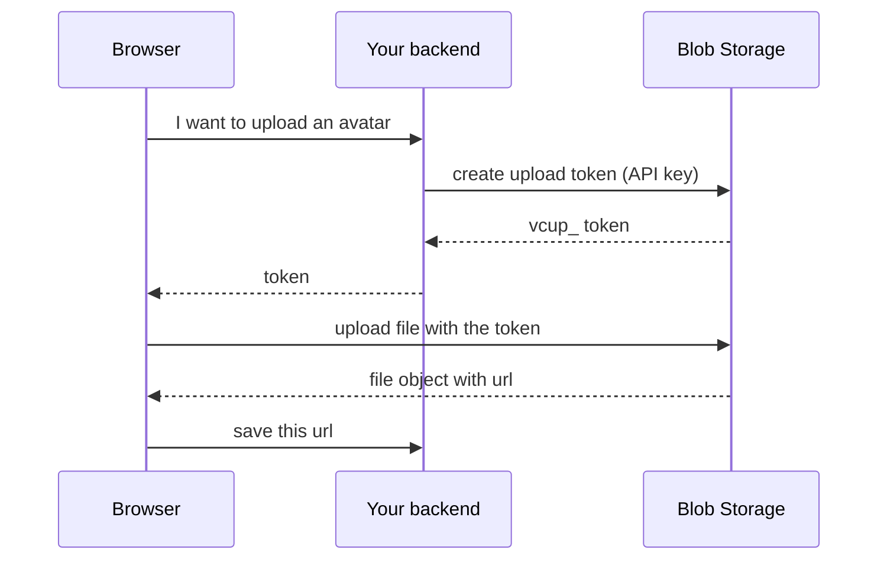

To accept uploads from your users, your backend creates a short-lived **upload token** and the browser sends the file straight to Blob Storage with it. The file never passes through your application and your API key never reaches the browser.



<Steps>
  <Step title="Create the token on your backend">
    Fix everything the browser must not choose: folder, size, extensions and visibility. A token with a `prefix` adds a random suffix to each name, so users cannot overwrite each other.

    <CodeGroup>

    ```javascript JavaScript
    import { BlobClient } from "@vertracloud/blob";
    const blob = new BlobClient({ apiKey: process.env.VERTRA_API_KEY });

    app.post("/avatar-token", async (req, res) => {
      const { token } = await blob.createUploadToken({
        prefix: `avatars/${req.user.id}/`,
        visibility: "public",
        maxSize: 5_000_000,
        allowedExtensions: ["png", "jpg", "webp"],
        expiresIn: 300,
        maxUses: 1,
      });
      res.json({ token, path: `avatars/${req.user.id}/avatar.png` });
    });
    ```

    ```python Python
    token = client.blob.create_upload_token(
        prefix=f"avatars/{user_id}/", visibility="public",
        max_size=5_000_000, allowed_extensions=["png", "jpg", "webp"],
        expires_in=300, max_uses=1,
    )
    ```

    ```go Go
    token, err := client.Blob.CreateUploadToken(ctx, vertracloud.BlobUploadTokenInput{
        Prefix:            fmt.Sprintf("avatars/%s/", userID),
        Visibility:        "public",
        MaxSize:           5_000_000,
        AllowedExtensions: []string{"png", "jpg", "webp"},
        ExpiresIn:         300,
        MaxUses:           1,
    })
    // send token.Token to the browser
    ```

    ```bash cURL
    curl -X POST "https://blob.vertracloud.app/v1/upload-tokens" \
      -H "Authorization: Bearer $VERTRA_API_KEY" -H "Content-Type: application/json" \
      -d '{ "prefix": "avatars/42/", "visibility": "public", "max_size": 5000000,
            "allowed_extensions": ["png","jpg","webp"], "expires_in": 300, "max_uses": 1 }'
    ```

    </CodeGroup>

    A token never replaces an existing file unless you create it with `overwrite: true` (the default is `false`), so the user can't overwrite what is already stored.

    Authenticate your own endpoint so only signed-in users can get a token.
  </Step>
  <Step title="Upload from the browser">
    ```javascript
    import { BlobClient } from "@vertracloud/blob";

    const { token, path } = await (await fetch("/avatar-token", { method: "POST" })).json();
    const blob = new BlobClient({ uploadToken: token });

    // the path must sit inside the token's prefix
    const obj = await blob.put(path, file, {
      onProgress: ({ loaded, total }) => setPercent(loaded / total),
    });
    ```
  </Step>
  <Step title="Save the URL">
    Send `obj.url` (and `obj.id`) to your backend and store them with the user. Use the `id` for later changes; the URL only changes if you move the file.

    ```javascript
    await fetch("/me/avatar", { method: "PUT", body: JSON.stringify({ url: obj.url, id: obj.id }) });
    ```
  </Step>
</Steps>

## Troubleshooting

| Symptom | Cause |
|---|---|
| `BLOB_UPLOAD_TOKEN_INVALID` | Token expired or its API key was revoked; create a new one |
| `BLOB_UPLOAD_TOKEN_EXHAUSTED` | `max_uses` reached; raise it or create a token per upload |
| `BLOB_UPLOAD_TOKEN_CONSTRAINT` | The path, size or extension is outside what the token allows |
| `BLOB_UPLOAD_TOKEN_NOT_ALLOWED` | A token only works on upload routes |

More on tokens in [Authentication](/blob/authentication#upload-tokens), size and path rules in [Uploads](/blob/uploads), and per-folder limits in [Folder rules](/blob/folder-rules).
