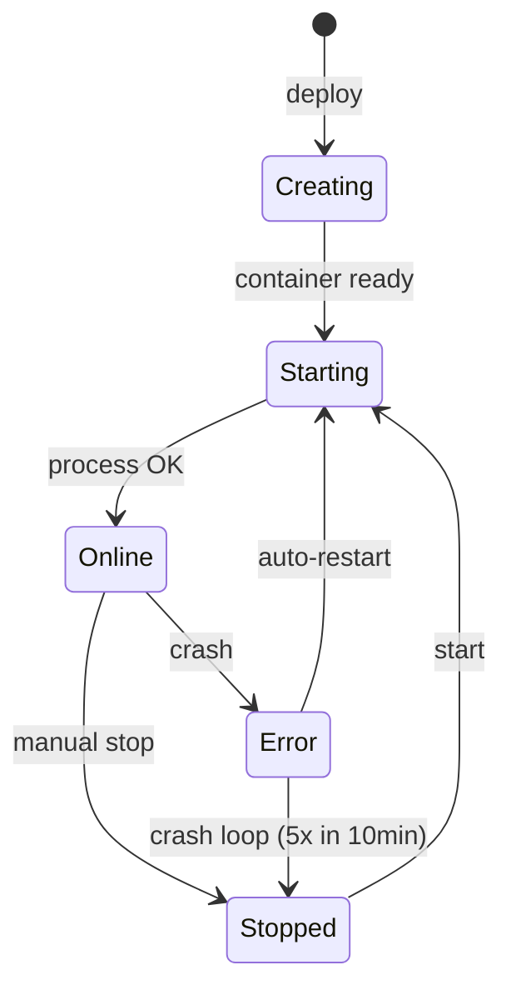

## O que é uma aplicação na Vertra Cloud?

Uma aplicação na Vertra Cloud é o seu código rodando em um container isolado, com memória e
armazenamento dedicados e — quando publicada na web — um subdomínio exclusivo `*.vertraweb.app` com
HTTPS. A Vertra Cloud é uma plataforma brasileira de hospedagem de aplicações (PaaS), e a aplicação é
a unidade que ela faz deploy, reinicia, gera snapshots e cobra pela RAM do seu plano.

## Quais são os tipos de aplicação?

São dois: **site**, que escuta em uma porta HTTP e recebe um subdomínio, e **bot**, um processo em
segundo plano sem porta exposta. O tipo não é fixo na criação: publicar ou despublicar uma aplicação
o troca.

<Tabs>
  <Tab title="Site">
    Aplicações web acessíveis via HTTP/HTTPS. Elas recebem um subdomínio e podem ter um domínio personalizado.

    Exemplos: APIs REST, aplicações Next.js, sites dinâmicos, dashboards.
  </Tab>
  <Tab title="Bot">
    Aplicações que rodam em segundo plano sem expor porta HTTP. Ideais para bots do Discord, automações e workers.

    Exemplos: bots do Discord, bots do Telegram, cron jobs, workers de fila.
  </Tab>
</Tabs>

O tipo não é permanente. Uma aplicação criada sem publicação na web pode ser publicada depois, e uma
publicada pode voltar a ser uma aplicação privada, pelas configurações de **Rede** da aplicação ou
pela [Publicar aplicação na web](/pt-br/api-reference/endpoint/apps/network/publish).

<Warning>
  Ligar ou desligar a publicação **recria o container, e a aplicação reinicia**. E despublicar
  **libera o subdomínio** — ele não fica reservado para você, então outra pessoa pode registrá-lo.
</Warning>

Você também pode criar uma aplicação a partir de um [template](/pt-br/templates/overview): um projeto pronto que você implanta em poucos cliques, às vezes junto com o banco de dados, como uma [stack](/pt-br/templates/use/stacks).

## Linguagens suportadas

A plataforma suporta o deploy de aplicações em várias linguagens. O ambiente de execução é configurado
automaticamente de acordo com a linguagem selecionada.

<CardGroup cols={3}>
  <Card title="JavaScript" icon="js">
    Node.js 22, 24 com npm/yarn
  </Card>
  <Card title="TypeScript" icon="js">
    Node.js 22, 24 via ts-node
  </Card>
  <Card title="Python" icon="python">
    3.11, 3.12, 3.13 com pip
  </Card>
  <Card title="Go" icon="golang">
    1.26, 1.27 com go mod
  </Card>
  <Card title="Rust" icon="rust">
    1.99 com cargo
  </Card>
  <Card title="Java" icon="java">
    17, 21 com maven/gradle
  </Card>
  <Card title="PHP" icon="php">
    8.2, 8.3, 8.4 com composer
  </Card>
  <Card title="Ruby" icon="gem">
    3.3, 3.4 com bundler
  </Card>
  <Card title="Bun" icon="bolt">
    1.3, 1.4
  </Card>
  <Card title="Deno" icon="code">
    2.8, 2.9 com deno.json
  </Card>
  <Card title=".NET (C#)" icon="code">
    10.0 com dotnet publish
  </Card>
  <Card title="Elixir" icon="code">
    1.20 (OTP 28) com mix, Phoenix suportado
  </Card>
  <Card title="Static" icon="file-code">
    HTML, CSS, JavaScript puro
  </Card>
</CardGroup>

<Info>
  A plataforma detecta a linguagem pelos arquivos de manifesto na raiz do projeto. Para forçar uma, defina
  `LANGUAGE=<slug>` no [`vertracloud.config`](/pt-br/configuration) ou envie `language` ao
  [criar a aplicação](/pt-br/api-reference/endpoint/apps/create).
</Info>

<Info>
  As versões disponíveis vêm de [Listar runtimes](/pt-br/api-reference/endpoint/apps/runtimes). Use
  `recommended` para a versão estável, `latest` para a mais nova, ou fixe uma das versões listadas pelo
  número. Uma versão que não existe para a linguagem da aplicação é recusada com `INVALID_VERSION`.
</Info>

## Ciclo de vida



Uma aplicação passa pelos seguintes estados:

| Estado | Descrição | Ícone |
|-------|-----------|:-----:|
| **Criando** (`building`) | A aplicação foi aceita e a instalação e o build rodam em segundo plano; a maioria das ações responde `409 APP_BUILDING` até terminar como `up` ou `down` | ↻ |
| **Iniciando** | Container criado, processo de inicialização em execução | ... |
| **Online** | Aplicação em execução e acessível | ● |
| **Parada** | Parada manualmente | ○ |
| **Erro** | O container encontrou um erro durante a execução | ! |

## Comando de build

O campo opcional `build_command`, disponível em todos os planos, roda depois da instalação das
dependências e antes de a aplicação iniciar — em todo deploy que instala ou altera código: criação,
upload de ZIP, deploy pelo GitHub, reinstalação de dependências ou alteração do próprio comando. Um
restart simples pula essa etapa quando o build anterior já teve sucesso com o mesmo comando.

O build roda em um ambiente de build isolado: 2× a RAM da aplicação (mínimo de 1.024 MB, máximo de
4.096 MB), com timeout de 10 minutos. Com um comando de build, as `devDependencies` também são
instaladas. Um comando que falha faz o deploy falhar (`BUILD_FAILED`); passar do timeout também
(`BUILD_TIMEOUT`). Uma aplicação nova continua sendo criada, parada, para que você possa ler a saída do
build nos logs, corrigir e iniciar de novo.

| Framework | Build | Start |
|---|---|---|
| Next.js | `npm run build` | `npx next start -p 80` |
| Nuxt | `npm run build` | `PORT=80 node .output/server/index.mjs` |
| SvelteKit (adapter-node) | `npm run build` | `PORT=80 node build` |
| Remix | `npm run build` | `npx remix-serve build/server/index.js` |
| React Router v7 | `npm run build` | `npx react-router-serve ./build/server/index.js` |
| Astro | `npm run build` | `npx astro preview --host 0.0.0.0 --port 80` |
| Gatsby | `npm run build` | `npx gatsby serve --host 0.0.0.0 -p 80` |
| Vite | `npm run build` | `npx vite preview --host 0.0.0.0 --port 80` |

As aplicações devem escutar na **porta 80**. Ao criar uma aplicação a partir de um ZIP no painel, a
plataforma sugere os comandos de build e start acima, a partir das dependências declaradas no
`package.json` (Next.js, Nuxt, SvelteKit, Remix, React Router, Astro, Gatsby e Vite) — você pode editar
os dois antes de criar.

## Arquivo de configuração

Um arquivo opcional `vertracloud.config` (`KEY=value`, uma por linha) na raiz do ZIP enviado preenche
previamente o fluxo de criação: `NAME`, `DESCRIPTION`, `MAIN`, `MEMORY`, `BUILD`, `START` e `SUBDOMAIN`.
A configuração real fica no painel (aba **Config**). O arquivo não é armazenado no volume da
aplicação; ele é gerado a partir das suas configurações atuais quando você baixa o projeto ou cria um
snapshot. Cada chave, seus limites e o que pode mudar depois estão em [Configuração](/pt-br/configuration).

## Gerenciador de arquivos

O painel inclui um gerenciador de arquivos integrado, com realce de sintaxe e edição de código, que
permite:

<AccordionGroup>
  <Accordion title="Navegação e edição" icon="folder-open">
    - Árvore de arquivos com até 6 níveis de profundidade
    - Realce de sintaxe para todas as linguagens suportadas
    - Criar, editar, mover e excluir arquivos e pastas
  </Accordion>
  <Accordion title="Envio de arquivos" icon="upload">
    - Arrastar e soltar arquivos individuais ou um ZIP
    - Validação automática de arquivos e diretórios
    - Extração automática de arquivos ZIP
  </Accordion>
</AccordionGroup>

No diálogo **Enviar alterações**, o campo **Destino do commit** começa com a pasta que você tem aberta no
gerenciador de arquivos. Use **Selecionar** para escolher qualquer outra pasta da aplicação. Os arquivos
são gravados nessa pasta, e um ZIP é extraído dentro dela, mesclado com os arquivos que já estão lá em
vez de substituir a pasta. A API aceita a mesma escolha pelo parâmetro de query `path` em
[Enviar arquivos para a aplicação](/pt-br/api-reference/endpoint/apps/filemanager/upload).

## Variáveis de ambiente

As variáveis de ambiente são injetadas no container na inicialização e ficam disponíveis como variáveis
do sistema. Gerencie-as pelo painel ou pela API.

<Tabs>
  <Tab title="Pelo painel">
    Acesse a aplicação → **Variáveis de Ambiente** → adicione, edite ou remova variáveis.
  </Tab>
  <Tab title="Pela API">
    ```bash
    curl -H "Authorization: Bearer $VERTRA_API_KEY" \
         https://api.vertracloud.app/v1/apps/{id}/envs

    curl -X POST -H "Authorization: Bearer $VERTRA_API_KEY" \
         -H "Content-Type: application/json" \
         -d '[{"key":"DATABASE_URL","value":"..."}]' \
         https://api.vertracloud.app/v1/apps/{id}/envs
    ```
  </Tab>
</Tabs>

## Snapshots

Snapshots são cópias do estado da sua aplicação em um momento específico. Eles permitem criar snapshots
manuais, restaurar snapshots anteriores e baixar o conteúdo de qualquer snapshot.

<Warning>
  A restauração de snapshots tem um período de espera entre as operações para evitar uso excessivo de recursos.
</Warning>

## Domínio personalizado

Cada aplicação publicada recebe um subdomínio padrão (ex.: `my-app.vertraweb.app`). Você também pode
conectar os seus próprios domínios com SSL automático, quantos o seu plano permitir. Adicionar ou alterar
um domínio nunca reinicia a aplicação. Despublicar a aplicação remove os domínios personalizados junto
com o subdomínio; depois, exclua os registros `CNAME` e `TXT` no seu provedor de DNS.

<Steps>
  <Step title="Adicionar domínio">
    Na aba **Rede** da aplicação, adicione o domínio. O domínio raiz ou o `www` é adicionado junto com o
    seu complemento automático.
  </Step>
  <Step title="Configurar DNS">
    Aponte os registros DNS conforme indicado no painel.
  </Step>
  <Step title="Verificação e SSL">
    A plataforma verifica a configuração do DNS e provisiona o certificado SSL automaticamente.
  </Step>
</Steps>

Cada domínio pode usar sua própria porta, prefixo de caminho ou redirecionamento. Veja
[Conectar domínios personalizados](/pt-br/guides/custom-domain).

<Note>
  Domínios personalizados estão disponíveis a partir do plano **Intermediary** (1 domínio por aplicação);
  os níveis Enterprise superiores permitem até 20. O `www` automático não conta.
</Note>

## Reinício automático e detecção de falhas

O reinício automático fica **ativado por padrão em todos os planos** — não há botão para desligá-lo nem
nada a configurar:

<AccordionGroup>
  <Accordion title="Como funciona o reinício automático" icon="rotate">
    - Containers que saem inesperadamente são reiniciados automaticamente
    - Códigos de saída normais (0) e erros de sintaxe ou de dependências **não** disparam o reinício
    - Um intervalo de 1 hora é aplicado entre reinícios consecutivos
    - O container precisa ficar online por pelo menos 60 segundos para contar como estável
  </Accordion>
  <Accordion title="Detecção de crash loop" icon="shield">
    - Se um container cair **5 vezes em 10 minutos**, o reinício automático é desativado por 24 horas
    - O sistema registra o motivo do desligamento pelo reinício automático
    - Depois de 24 horas, o reinício automático volta a funcionar sozinho
  </Accordion>
</AccordionGroup>

## Logs em tempo real

O terminal do painel mostra a saída da aplicação ao vivo; quando a aplicação está parada, ele mostra os
logs mais recentes. Fora do painel, use `vertra logs -f` na [CLI](/pt-br/cli) ou em
[Logs da aplicação](/pt-br/api-reference/endpoint/apps/logs).

## Métricas

O painel exibe métricas de desempenho em tempo real:

<CardGroup cols={3}>
  <Card title="CPU" icon="microchip">
    Percentual de uso de CPU do container em tempo real.
  </Card>
  <Card title="Memória" icon="memory">
    Consumo atual de RAM vs. o limite alocado.
  </Card>
  <Card title="Rede" icon="network-wired">
    Bytes recebidos e enviados, com o total acumulado.
  </Card>
</CardGroup>
