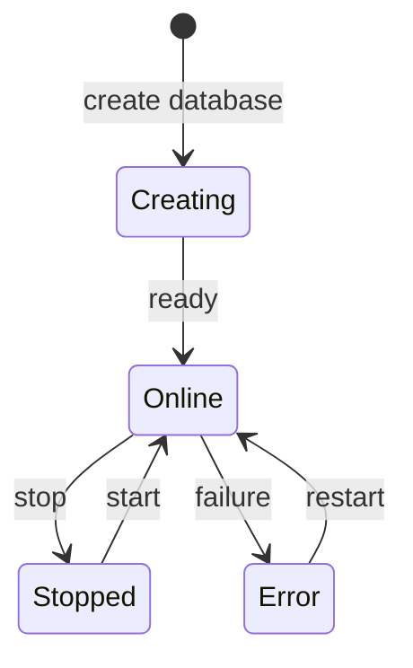

## O que é um banco de dados gerenciado na Vertra Cloud?

Um banco de dados gerenciado na Vertra Cloud é uma instância de PostgreSQL, MongoDB, Redis ou MySQL que a
plataforma provisiona, protege e monitora para você: o TLS é obrigatório, os certificados de CA, servidor
e cliente são gerados automaticamente, e cada banco roda no próprio container, com memória e
armazenamento dedicados.

## Quais motores de banco estão disponíveis?

Quatro: PostgreSQL (18 ou 17), MongoDB (8.0 ou 9.0), Redis (8.2 ou 7.2) e MySQL (9.7 ou 8.4). Você escolhe
a versão ao criar o banco, e a recomendada é a padrão. Todos os motores exigem TLS **e um certificado de
cliente** — só a senha nunca conecta.

<CardGroup cols={2}>
  <Card title="PostgreSQL 18 / 17" icon="elephant">
    Banco relacional com SQL completo, suporte a JSONB e extensões.

    **Usuário**: `vertracloud` &nbsp;|&nbsp; **Banco de dados**: `vertracloud` &nbsp;|&nbsp; **Autenticação**: senha + certificado de cliente
  </Card>
  <Card title="MongoDB 8.0 / 9.0" icon="leaf">
    Banco NoSQL orientado a documentos, para dados flexíveis.

    **Usuário**: `vertracloud` &nbsp;|&nbsp; **Banco de dados**: `vertracloud` &nbsp;|&nbsp; **Banco de autenticação**: `admin` &nbsp;|&nbsp; **Autenticação**: senha + certificado de cliente
  </Card>
  <Card title="Redis 8.2 / 7.2" icon="bolt">
    Armazenamento em memória para cache de alto desempenho, filas e pub/sub.

    **Usuário**: `vertracloud` &nbsp;|&nbsp; **Autenticação**: usuário + senha + certificado de cliente
  </Card>
  <Card title="MySQL 9.7 / 8.4" icon="database">
    Banco relacional popular, com transações ACID e um grande ecossistema.

    **Usuário**: `vertracloud` &nbsp;|&nbsp; **Banco de dados**: `vertracloud` &nbsp;|&nbsp; **Autenticação**: senha + certificado de cliente X509
  </Card>
</CardGroup>

## Com qual usuário eu me conecto?

Bancos criados a partir da [v26.4.8](/pt-br/changelog/v26-4-8) recebem o usuário `vertracloud` e um banco
padrão chamado `vertracloud`. Ele é dono dos seus dados e, dependendo do motor, pode criar bancos e papéis
(PostgreSQL), usar todos os bancos (MongoDB) ou executar todos os comandos de dados (Redis). Como em outros
serviços de banco gerenciado, a administração no nível do servidor (configurações do servidor, usuários
administradores, backups e restaurações) fica a cargo da plataforma.

Bancos criados antes disso mantêm o usuário padrão do motor: `postgres` (banco `postgres`) no PostgreSQL,
`default` no MongoDB e no Redis, e `root` (banco `default`) no MySQL. O campo `username` em
[Obter banco de dados](/api-reference/endpoint/databases/get) sempre indica qual usar.

## O que preciso para me conectar?

São quatro itens, todos na página do banco no painel (ou pela API):

- **Host** — `<id-do-banco-sem-hifens>.db.usa1.vertraweb.app`, mostrado na página do banco e em
  [Obter banco de dados](/api-reference/endpoint/databases/get).
- **Porta** — **única por banco**, não a porta padrão do motor (5432, 27017, 6379, 3306). Sempre copie-a da
  página do banco ou da resposta da API.
- **Usuário** — `vertracloud` (ou o usuário do motor, em bancos mais antigos), mostrado na página do banco e
  como `username` em [Obter banco de dados](/api-reference/endpoint/databases/get).
- **Senha** — mostrada na página do banco; [redefina-a](/api-reference/endpoint/databases/credentials/resetpassword)
  se necessário.
- **Certificados** — baixe-os na aba **Certificados** do banco ou pelo
  [Obter certificado do banco de dados](/api-reference/endpoint/databases/credentials/get):

| Arquivo | O que é | Use como |
|---|---|---|
| `certificate-<id>.crt` | Seu certificado de cliente | certificado de cliente (`cert`, `sslcert`, `--cert`) |
| `certificate-<id>.key` | Sua chave privada de cliente | chave de cliente (`key`, `sslkey`, `--key`) |
| `certificate-<id>.pem` | Pacote: chave de cliente + certificado de cliente + a CA que assina o servidor | arquivo de CA (`ca`, `sslrootcert`, `--cacert`) e, no MongoDB, o arquivo de certificado com chave |

O certificado do servidor corresponde ao host do banco, então a verificação completa (`verify-full`,
`VERIFY_IDENTITY`, `rejectUnauthorized: true`) funciona. Mantenha os arquivos `.key` e `.pem` privados — eles
autenticam como você. [Redefinir os certificados](/api-reference/endpoint/databases/credentials/reset)
emite novos certificados e invalida os arquivos antigos.

## Como me conecto a cada motor?

Nos exemplos, `<host>`, `<port>` e `<password>` vêm da página do banco; o usuário e o banco são
`vertracloud` (troque pelo `username` do seu banco se ele foi criado antes da v26.4.8); e
`certificate.crt` / `certificate.key` / `certificate.pem` são os três arquivos baixados.

<Tabs>
  <Tab title="PostgreSQL">
    ```javascript Node.js (pg)
    const { Pool } = require('pg');
    const fs = require('fs');

    const pool = new Pool({
      host: '<host>',
      port: <port>,
      user: 'vertracloud',
      password: '<password>',
      database: 'vertracloud',
      ssl: {
        ca: fs.readFileSync('certificate.pem'),
        cert: fs.readFileSync('certificate.crt'),
        key: fs.readFileSync('certificate.key'),
        rejectUnauthorized: true,
      },
    });
    ```

    ```python Python (psycopg)
    import psycopg

    conn = psycopg.connect(
        host="<host>", port=<port>, user="vertracloud", password="<password>", dbname="vertracloud",
        sslmode="verify-full", sslrootcert="certificate.pem",
        sslcert="certificate.crt", sslkey="certificate.key",
    )
    ```

    ```bash psql
    psql "host=<host> port=<port> dbname=vertracloud user=vertracloud password=<password> sslmode=verify-full sslrootcert=certificate.pem sslcert=certificate.crt sslkey=certificate.key"
    ```
  </Tab>
  <Tab title="MongoDB">
    O usuário fica no banco `admin`, então a URI sempre precisa de `authSource=admin`.

    ```javascript Node.js (mongodb)
    const { MongoClient } = require('mongodb');

    const client = new MongoClient('mongodb://vertracloud:<password>@<host>:<port>/vertracloud?authSource=admin', {
      tls: true,
      tlsCAFile: 'certificate.pem',
      tlsCertificateKeyFile: 'certificate.pem',
    });
    ```

    ```bash mongosh
    mongosh "mongodb://vertracloud:<password>@<host>:<port>/vertracloud?authSource=admin" --tls --tlsCAFile certificate.pem --tlsCertificateKeyFile certificate.pem
    ```
  </Tab>
  <Tab title="Redis">
    ```javascript Node.js (ioredis)
    const Redis = require('ioredis');
    const fs = require('fs');

    const redis = new Redis({
      host: '<host>',
      port: <port>,
      username: 'vertracloud',
      password: '<password>',
      tls: {
        servername: '<host>',
        ca: fs.readFileSync('certificate.pem'),
        cert: fs.readFileSync('certificate.crt'),
        key: fs.readFileSync('certificate.key'),
      },
    });
    ```

    ```bash redis-cli
    redis-cli -h <host> -p <port> --user vertracloud -a <password> --tls --cacert certificate.pem --cert certificate.crt --key certificate.key
    ```
  </Tab>
  <Tab title="MySQL">
    ```javascript Node.js (mysql2)
    const mysql = require('mysql2/promise');
    const fs = require('fs');

    const connection = await mysql.createConnection({
      host: '<host>',
      port: <port>,
      user: 'vertracloud',
      password: '<password>',
      database: 'vertracloud',
      ssl: {
        ca: fs.readFileSync('certificate.pem'),
        cert: fs.readFileSync('certificate.crt'),
        key: fs.readFileSync('certificate.key'),
      },
    });
    ```

    ```bash mysql
    mysql -h <host> -P <port> -u vertracloud -p vertracloud --ssl-mode=VERIFY_IDENTITY --ssl-ca=certificate.pem --ssl-cert=certificate.crt --ssl-key=certificate.key
    ```
  </Tab>
</Tabs>

<Warning>
  Uma conexão só com a senha — ou com TLS mas sem o certificado de cliente — é recusada por todos os motores.
  A maioria dos erros "connection refused" ou "handshake failed" vem de um `.crt`/`.key` ausente ou da porta
  padrão do motor usada no lugar da porta do próprio banco.
</Warning>

## Ciclo de vida



| Estado | Descrição | Indicador |
|-------|-----------|:---------:|
| **Criando** | Container sendo provisionado com os certificados TLS | ↻ |
| **Online** | Banco em execução e aceitando conexões | ● |
| **Parado** | Parado manualmente (dados preservados) | ○ |
| **Erro** | Problema durante a inicialização ou a execução | ! |

## Operações disponíveis

<CardGroup cols={2}>
  <Card title="Iniciar / Parar / Reiniciar" icon="play">
    Controla o ciclo de vida do container. Os dados são preservados ao parar ou reiniciar.
  </Card>
  <Card title="Resetar" icon="trash">
    Apaga todos os dados e recria o banco do zero. **Ação irreversível.**
  </Card>
  <Card title="Redefinir senha" icon="key">
    Gera uma nova senha aleatória e segura para o banco.
  </Card>
  <Card title="Redefinir certificados" icon="certificate">
    Regenera todos os certificados TLS (CA, servidor e cliente).
  </Card>
  <Card title="Baixar snapshot" icon="download">
    Baixa uma cópia dos dados do banco.
  </Card>
  <Card title="Restaurar snapshot" icon="clock-rotate-left">
    Restaura o banco a partir de um snapshot anterior.
  </Card>
</CardGroup>

<Warning>
  A operação **Resetar** é destrutiva e apaga todos os dados do banco. Essa ação não pode ser desfeita.
</Warning>

## Métricas

O painel exibe métricas em tempo real para cada banco:

<CardGroup cols={3}>
  <Card title="CPU" icon="microchip">
    Uso de CPU do container.
  </Card>
  <Card title="Memória" icon="memory">
    Consumo atual de RAM.
  </Card>
  <Card title="Armazenamento" icon="hard-drive">
    Espaço em disco usado vs. a cota.
  </Card>
</CardGroup>

## Armazenamento

O armazenamento dos bancos tem limites rígidos aplicados no nível do container, o que garante que um banco
não consuma mais espaço do que o alocado.
