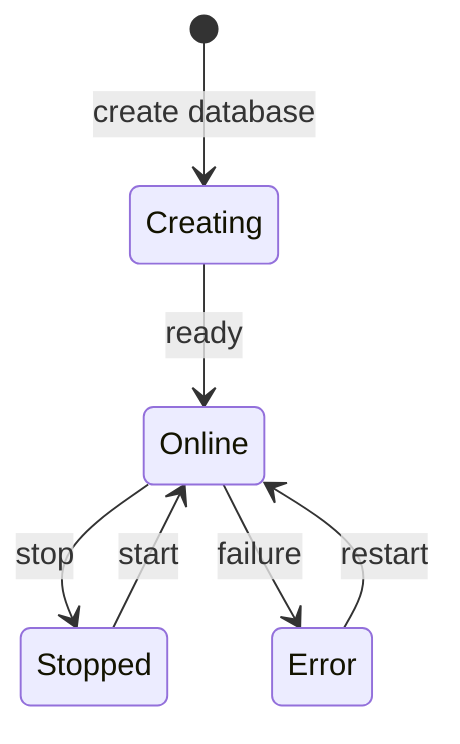

## O que é um banco de dados gerenciado na Vertra Cloud?

Um banco de dados gerenciado na Vertra Cloud é uma instância de PostgreSQL, MongoDB, Redis ou MySQL que a
plataforma provisiona, protege e monitora para você: o TLS é obrigatório, os certificados de CA, servidor
e cliente são gerados automaticamente, e cada banco roda no próprio container, com memória e
armazenamento dedicados.

## Quais motores de banco estão disponíveis?

Quatro: PostgreSQL (18 ou 17), MongoDB (8.0 ou 9.0), Redis (8.2 ou 7.2) e MySQL (9.7 ou 8.4). Você escolhe
a versão ao criar o banco, e a recomendada é a padrão. Todos os motores exigem TLS **e um certificado de
cliente** — só a senha nunca conecta.

<CardGroup cols={2}>
  <Card title="PostgreSQL 18 / 17" icon="elephant">
    Banco relacional com SQL completo, suporte a JSONB e extensões.

    **Usuário**: `vertracloud` &nbsp;|&nbsp; **Banco de dados**: `vertracloud` &nbsp;|&nbsp; **Autenticação**: senha + certificado de cliente
  </Card>
  <Card title="MongoDB 8.0 / 9.0" icon="leaf">
    Banco NoSQL orientado a documentos, para dados flexíveis.

    **Usuário**: `vertracloud` &nbsp;|&nbsp; **Banco de dados**: `vertracloud` &nbsp;|&nbsp; **Banco de autenticação**: `admin` &nbsp;|&nbsp; **Autenticação**: senha + certificado de cliente
  </Card>
  <Card title="Redis 8.2 / 7.2" icon="bolt">
    Armazenamento em memória para cache de alto desempenho, filas e pub/sub.

    **Usuário**: `vertracloud` &nbsp;|&nbsp; **Autenticação**: usuário + senha + certificado de cliente
  </Card>
  <Card title="MySQL 9.7 / 8.4" icon="database">
    Banco relacional popular, com transações ACID e um grande ecossistema.

    **Usuário**: `vertracloud` &nbsp;|&nbsp; **Banco de dados**: `vertracloud` &nbsp;|&nbsp; **Autenticação**: senha + certificado de cliente X509
  </Card>
</CardGroup>

## Com qual usuário eu me conecto?

Bancos criados a partir da [v26.4.8](/pt-br/changelog/v26-4-8) recebem o usuário `vertracloud` e um banco
padrão chamado `vertracloud`. Ele é dono dos seus dados e, dependendo do motor, pode criar bancos e papéis
(PostgreSQL), usar todos os bancos (MongoDB) ou executar todos os comandos de dados (Redis). Como em outros
serviços de banco gerenciado, a administração no nível do servidor (configurações do servidor, usuários
administradores, backups e restaurações) fica a cargo da plataforma.

Bancos criados antes disso mantêm o usuário padrão do motor: `postgres` (banco `postgres`) no PostgreSQL,
`default` no MongoDB e no Redis, e `root` (banco `default`) no MySQL. O campo `username` em
[Obter banco de dados](/pt-br/api-reference/endpoint/databases/get) sempre indica qual usar.

## Quais extensões do PostgreSQL eu posso usar?

Todas as extensões que vêm com o PostgreSQL e são marcadas como confiáveis (trusted): o seu próprio usuário as
ativa com `CREATE EXTENSION` num banco do qual é dono, sem superuser e sem abrir chamado. Migrações que criam as
próprias extensões (Flyway, Prisma, Alembic, Rails) rodam como estão.

`btree_gin`, `btree_gist`, `citext`, `cube`, `dict_int`, `fuzzystrmatch`, `hstore`, `intarray`, `isn`, `lo`,
`ltree`, `pg_trgm`, `pgcrypto`, `seg`, `tablefunc`, `tcn`, `tsm_system_rows`, `tsm_system_time`, `unaccent` e `uuid-ossp`. O `plpgsql` já vem instalado, então funções, triggers e constraint triggers funcionam.

Extensões que exigem superuser, como `dblink`, `postgres_fdw`, `file_fdw` e `pg_stat_statements`, não estão
disponíveis, nem as de terceiros, como PostGIS ou `pgvector`. Para listar o que o seu banco aceita, rode
`SELECT DISTINCT name FROM pg_available_extension_versions WHERE trusted;`.

Collations ICU também funcionam, por exemplo `CREATE COLLATION pt_br_icu (provider = icu, locale = 'pt-BR');`.

## O que preciso para me conectar?

São quatro itens, todos na página do banco no painel (ou pela API):

- **Host** — `<id-do-banco-sem-hifens>.db.usa1.vertraweb.app`, mostrado na página do banco e em
  [Obter banco de dados](/pt-br/api-reference/endpoint/databases/get).
- **Porta** — **única por banco**, não a porta padrão do motor (5432, 27017, 6379, 3306). Sempre copie-a da
  página do banco ou da resposta da API.
- **Usuário** — `vertracloud` (ou o usuário do motor, em bancos mais antigos), mostrado na página do banco e
  como `username` em [Obter banco de dados](/pt-br/api-reference/endpoint/databases/get).
- **Senha** — mostrada na página do banco; [redefina-a](/pt-br/api-reference/endpoint/databases/credentials/resetpassword)
  se necessário.
- **Certificados** — baixe-os na aba **Certificados** do banco ou pelo
  [Obter certificado do banco de dados](/pt-br/api-reference/endpoint/databases/credentials/get):

| Arquivo | O que é | Use como |
|---|---|---|
| `certificate-<id>.ca.pem` | A CA que assina o certificado de servidor do banco | arquivo de CA (`ca`, `sslrootcert`, `--cacert`, `tlsCAFile`, `--ssl-ca`) |
| `certificate-<id>.crt` | Seu certificado de cliente — **não** é a CA | certificado de cliente (`cert`, `sslcert`, `--cert`, `--ssl-cert`) |
| `certificate-<id>.key` | Sua chave privada de cliente | chave de cliente (`key`, `sslkey`, `--key`, `--ssl-key`) |
| `certificate-<id>.pem` | Pacote: chave de cliente + certificado de cliente + a CA, nessa ordem | arquivo de certificado com chave do MongoDB (`tlsCertificateKeyFile`) |
| `certificate-<id>.p12` | Sua chave e seu certificado de cliente em PKCS#12, senha vazia | drivers que só aceitam uma identidade PKCS#12, como o [Prisma 6](#como-me-conecto-com-o-prisma-6) |

A maioria das conexões usa três deles: `.ca.pem`, `.crt` e `.key`. Bancos mais antigos podem não oferecer o
`.ca.pem`; nesses, use o `.pem` como arquivo de CA, já que a CA é a última parte dele.

O certificado do servidor corresponde ao host do banco, então a verificação completa (`verify-full`,
`VERIFY_IDENTITY`, `rejectUnauthorized: true`) funciona. Mantenha os arquivos `.key`, `.pem` e `.p12` privados —
eles autenticam como você. [Redefinir os certificados](/pt-br/api-reference/endpoint/databases/credentials/reset)
emite novos certificados e invalida os arquivos antigos.

## Como me conecto a cada motor?

Nos exemplos, `<host>`, `<port>` e `<password>` vêm da página do banco; o usuário e o banco são
`vertracloud` (troque pelo `username` do seu banco se ele foi criado antes da v26.4.8); e
`certificate.ca.pem` / `certificate.crt` / `certificate.key` / `certificate.pem` são os arquivos baixados.

<Tabs>
  <Tab title="PostgreSQL">
    ```javascript Node.js (pg)
    const { Pool } = require('pg');
    const fs = require('fs');

    const pool = new Pool({
      host: '<host>',
      port: <port>,
      user: 'vertracloud',
      password: '<password>',
      database: 'vertracloud',
      ssl: {
        ca: fs.readFileSync('certificate.ca.pem'),
        cert: fs.readFileSync('certificate.crt'),
        key: fs.readFileSync('certificate.key'),
        rejectUnauthorized: true,
      },
    });
    ```

    ```python Python (psycopg)
    import psycopg

    conn = psycopg.connect(
        host="<host>", port=<port>, user="vertracloud", password="<password>", dbname="vertracloud",
        sslmode="verify-full", sslrootcert="certificate.ca.pem",
        sslcert="certificate.crt", sslkey="certificate.key",
    )
    ```

    ```bash psql
    psql "host=<host> port=<port> dbname=vertracloud user=vertracloud password=<password> sslmode=verify-full sslrootcert=certificate.ca.pem sslcert=certificate.crt sslkey=certificate.key"
    ```
  </Tab>
  <Tab title="MongoDB">
    O usuário fica no banco `admin`, então a URI sempre precisa de `authSource=admin`.

    ```javascript Node.js (mongodb)
    const { MongoClient } = require('mongodb');

    const client = new MongoClient('mongodb://vertracloud:<password>@<host>:<port>/vertracloud?authSource=admin', {
      tls: true,
      tlsCAFile: 'certificate.ca.pem',
      tlsCertificateKeyFile: 'certificate.pem',
    });
    ```

    ```bash mongosh
    mongosh "mongodb://vertracloud:<password>@<host>:<port>/vertracloud?authSource=admin" --tls --tlsCAFile certificate.ca.pem --tlsCertificateKeyFile certificate.pem
    ```
  </Tab>
  <Tab title="Redis">
    ```javascript Node.js (ioredis)
    const Redis = require('ioredis');
    const fs = require('fs');

    const redis = new Redis({
      host: '<host>',
      port: <port>,
      username: 'vertracloud',
      password: '<password>',
      tls: {
        servername: '<host>',
        ca: fs.readFileSync('certificate.ca.pem'),
        cert: fs.readFileSync('certificate.crt'),
        key: fs.readFileSync('certificate.key'),
      },
    });
    ```

    ```bash redis-cli
    redis-cli -h <host> -p <port> --user vertracloud -a <password> --tls --cacert certificate.ca.pem --cert certificate.crt --key certificate.key
    ```
  </Tab>
  <Tab title="MySQL">
    ```javascript Node.js (mysql2)
    const mysql = require('mysql2/promise');
    const fs = require('fs');

    const connection = await mysql.createConnection({
      host: '<host>',
      port: <port>,
      user: 'vertracloud',
      password: '<password>',
      database: 'vertracloud',
      ssl: {
        ca: fs.readFileSync('certificate.ca.pem'),
        cert: fs.readFileSync('certificate.crt'),
        key: fs.readFileSync('certificate.key'),
      },
    });
    ```

    ```bash mysql
    mysql -h <host> -P <port> -u vertracloud -p vertracloud --ssl-mode=VERIFY_IDENTITY --ssl-ca=certificate.ca.pem --ssl-cert=certificate.crt --ssl-key=certificate.key
    ```
  </Tab>
</Tabs>

<Warning>
  Uma conexão só com a senha — ou com TLS mas sem o certificado de cliente — é recusada por todos os motores.
  A maioria dos erros "connection refused" ou "handshake failed" vem de um `.crt`/`.key` ausente ou da porta
  padrão do motor usada no lugar da porta do próprio banco.
</Warning>

### Por que a conexão com o meu banco de dados falha?

Quase toda falha é uma de três coisas: a porta errada, um arquivo de certificado no lugar errado
ou o usuário errado. Encontre abaixo a mensagem que você recebeu; os exemplos vêm do Node.js (`pg`), e
outros drivers descrevem a mesma causa com outras palavras.

| Mensagem de erro | Causa | Correção |
|---|---|---|
| `ECONNREFUSED` / `ETIMEDOUT` / `Connection refused` | Porta errada (a padrão do motor no lugar da porta do próprio banco) ou o banco não está **Online** | Copie a porta da página do banco e confira o status |
| `self-signed certificate in certificate chain` (`SELF_SIGNED_CERT_IN_CHAIN`), `certificate verify failed` | A CA está ausente ou é o arquivo errado — em geral o `.crt` passado como CA | Passe o `.ca.pem` como CA (`ca`, `sslrootcert`, `--cacert`) |
| `key values mismatch` (`ERR_OSSL_X509_KEY_VALUES_MISMATCH`) | O certificado de cliente e a chave não formam um par: arquivos trocados (o `.ca.pem` passado como certificado), de bancos diferentes ou de antes de uma redefinição de certificados | Use o `.crt` e o `.key` do mesmo download |
| `connection requires a valid client certificate` | O TLS está ativo, mas o certificado de cliente e a chave não foram enviados | Adicione o `.crt` e o `.key` (`cert`/`key`, `sslcert`/`sslkey`) |
| `pg_hba.conf rejects connection ... no encryption` | O TLS está desativado | Ative o TLS com os três arquivos; uma conexão sem TLS é sempre recusada |
| `pg_hba.conf rejects connection ... user "postgres"` | Usuário errado: bancos criados a partir da v26.4.8 usam `vertracloud` | Use o usuário mostrado na página do banco (`username` na API) |
| `password authentication failed for user` | Senha errada, ou ela mudou depois de **Redefinir senha** | Copie a senha novamente e reinicie a aplicação |
| `Hostname/IP does not match certificate's altnames` | Conexão por endereço IP ou por outro nome | Conecte-se pelo host mostrado na página do banco |
| `ENOENT: no such file or directory` | O caminho do certificado não existe onde o processo roda | Os caminhos são relativos ao diretório de trabalho; confira se os arquivos foram implantados |
| `Error opening a TLS connection` (Prisma `P1011`) | Mesmas causas das linhas de certificado acima | Veja [Prisma 6](#como-me-conecto-com-o-prisma-6) |

Situações que causam esses erros sem um motivo óbvio:

- **`sslmode` na URL sobrescreve o objeto `ssl` (Node.js `pg`, Drizzle).** Quando você passa uma
  `connectionString` com `?sslmode=require` e também um objeto `ssl: { ca, cert, key }`, a URL vence e
  os arquivos são ignorados, então você recebe `self-signed certificate in certificate chain` mesmo com os
  arquivos certos. Use um ou outro: o objeto `ssl` com uma URL sem `sslmode`, ou uma URL que carregue
  tudo (`?sslmode=verify-full&sslrootcert=certificate.ca.pem&sslcert=certificate.crt&sslkey=certificate.key`).
- **`rejectUnauthorized: "false"` (uma string) não desliga a verificação.** Só o booleano
  `false` desliga, e você não deve usá-lo: com o `.ca.pem`, a verificação completa funciona.
- **Certificados numa variável de ambiente.** Um PEM colado numa variável de uma linha geralmente
  chega com `\n` literais e não é lido como certificado. Guarde os arquivos no projeto e aponte
  as variáveis para os caminhos deles.
- **O `psql` recusa o arquivo da chave.** A libpq exige que o `.key` seja legível só por você; rode
  `chmod 600 certificate.key` depois de baixá-lo.
- **Depois de Redefinir certificados, tudo falha de uma vez.** A CA, o certificado de cliente e a chave
  mudam: baixe os novos arquivos, substitua todos e reinicie a aplicação.
- **Funciona localmente, falha na aplicação.** A pasta `certs/` não foi implantada (muitas vezes está no
  `.gitignore`), ou as variáveis de ambiente foram adicionadas sem reiniciar a aplicação.

### Certificados em aplicações ligadas a uma stack

Quando uma aplicação e um banco de dados são implantados juntos a partir de um [template](/pt-br/templates/use/stacks), a plataforma grava os certificados do banco na aplicação para você, em `/app/.vertra/certs/<database_id>/`: `ca.pem`, `client.crt`, `client.key`, `client.pem` (MongoDB) e `client.p12` (Prisma). Variáveis como a URL de conexão apontam para esses caminhos, então você não envia nada. Veja [Conectar bancos de dados](/pt-br/templates/use/connect-databases).

### Como me conecto com o Prisma 6?

O Prisma 6 só aceita certificado de cliente como identidade PKCS#12, então use o arquivo `client.p12` (criptografado com AES, senha vazia, portanto sem `sslpassword`) em `sslidentity` e a CA em `sslcert`:

```ini
DATABASE_URL=postgresql://vertracloud:<password>@<host>:<port>/vertracloud?sslmode=require&sslaccept=strict&sslcert=/app/.vertra/certs/<database_id>/ca.pem&sslidentity=/app/.vertra/certs/<database_id>/client.p12
```

Um template pode pedir essa URL pronta, mas ela nunca entra numa ligação por padrão, porque carrega a senha. Fora de uma stack, use o `certificate-<id>.ca.pem` baixado em `sslcert` e o `certificate-<id>.p12` em `sslidentity`. O Prisma 7 lê os arquivos PEM pela URL padrão do PostgreSQL e dispensa o `.p12`.

### Como me conecto com o Drizzle?

O Drizzle ORM usa o seu driver (`pg`), então passe o objeto `ssl` do exemplo do PostgreSQL. O Drizzle Kit
(`drizzle-kit migrate`, `push`, `pull` e `studio`) lê o `drizzle.config.ts`, onde o objeto `ssl`
só vale com credenciais `host`/`port`, não com `url`. A configuração completa, incluindo o Drizzle Studio,
está em [Conectar a um banco](/pt-br/guides/connect-database#use-o-drizzle-kit-e-o-drizzle-studio).

### O Python 3.13 conecta ao banco de dados?

Conecta, mas o Python 3.13 em diante liga verificações X.509 estritas no contexto TLS padrão (`ssl.create_default_context()`), e bancos criados antes da correção dos certificados podem falhar com `Missing Authority Key Identifier`. Quem usa o contexto padrão é afetado, como redis-py e pg8000; psycopg, asyncpg, PyMySQL e pymongo não são. Bancos novos e bancos cujos certificados você redefiniu já emitem certificados compatíveis. Se não puder redefinir agora, o redis-py 6 ou superior aceita `ssl_exclude_verify_flags=[ssl.VERIFY_X509_STRICT]`.

### O que acontece quando redefino os certificados?

A redefinição emite uma nova CA, um novo certificado de servidor e um novo de cliente, e invalida os arquivos antigos. Nas aplicações ligadas a uma stack, os arquivos em `/app/.vertra/certs/` são regravados automaticamente, mas o processo em execução ainda guarda os antigos: a resposta indica `restart_required` e lista as aplicações a reiniciar. Arquivos que você baixou e colocou num projeto por conta própria precisam ser baixados e implantados de novo.

## Ciclo de vida



| Estado | Descrição | Indicador |
|-------|-----------|:---------:|
| **Criando** | Container sendo provisionado com os certificados TLS | ↻ |
| **Online** | Banco em execução e aceitando conexões | ● |
| **Parado** | Parado manualmente (dados preservados) | ○ |
| **Erro** | Problema durante a inicialização ou a execução | ! |

## Operações disponíveis

<CardGroup cols={2}>
  <Card title="Iniciar / Parar / Reiniciar" icon="play">
    Controla o ciclo de vida do container. Os dados são preservados ao parar ou reiniciar.
  </Card>
  <Card title="Resetar" icon="trash">
    Apaga todos os dados e recria o banco do zero. **Ação irreversível.**
  </Card>
  <Card title="Redefinir senha" icon="key">
    Gera uma nova senha aleatória e segura para o banco.
  </Card>
  <Card title="Redefinir certificados" icon="certificate">
    Regenera todos os certificados TLS (CA, servidor e cliente).
  </Card>
  <Card title="Baixar snapshot" icon="download">
    Baixa uma cópia dos dados do banco.
  </Card>
  <Card title="Restaurar snapshot" icon="clock-rotate-left">
    Restaura o banco a partir de um snapshot anterior.
  </Card>
</CardGroup>

<Warning>
  A operação **Resetar** é destrutiva e apaga todos os dados do banco. Essa ação não pode ser desfeita.
</Warning>

## Métricas

O painel exibe métricas em tempo real para cada banco:

<CardGroup cols={3}>
  <Card title="CPU" icon="microchip">
    Uso de CPU do container.
  </Card>
  <Card title="Memória" icon="memory">
    Consumo atual de RAM.
  </Card>
  <Card title="Armazenamento" icon="hard-drive">
    Espaço em disco usado vs. a cota.
  </Card>
</CardGroup>

## Armazenamento

O armazenamento dos bancos tem limites rígidos aplicados no nível do container, o que garante que um banco
não consuma mais espaço do que o alocado.
